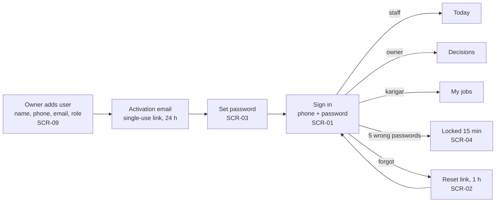
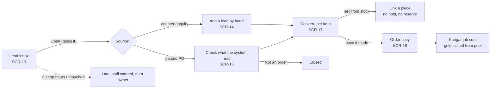
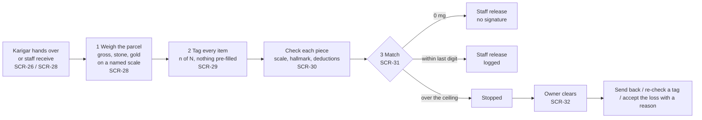
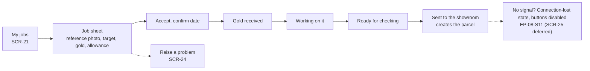

# JewelOps (JGD Enterprise Suite): UI/UX design

Consolidated UI/UX design for the production application, derived from the 586 user stories in 45 epics (`docs/stories/ALL-STORIES.md`). It builds on the existing UX work and does not replace it: the mockups numbered 01 to 28 in `docs/ux/mockups/` (27 SVG screens plus the Mermaid navigation map as number 10), `docs/ux/UX-REDESIGN-SPEC.md`, `docs/ux/SCOPE-ANALYSIS.md`, `docs/MOCKUP-COVERAGE.md` and `docs/EPICS.md`.

Documentation only. No application code or existing file is changed by this document, and no new mockups are drawn for the gaps in section 10.

## Contents

1. Purpose, sources and precedence
2. Design principles
3. Personas and roles
4. Information architecture and navigation
5. Key user flows per role
6. Screen inventory mapped to epics and stories
7. Design system foundations
8. Accessibility
9. Responsive and mobile behaviour
10. Gaps: epics and stories with no existing mockup
11. Reconciliation with existing mockups and UX-REDESIGN-SPEC
12. Assumptions and open UX questions
- Appendix A. Route catalogue

---

## 1. Purpose, sources and precedence

### 1.1 What this document is for

Designers use it to know which screens exist, which are drawn and which are not. Engineers use it to know which screen, state and component each story lands on. The owner uses it to see that the design follows the rules he has already settled (three roles, exact-match parcels, no money in v1).

### 1.2 Sources

| Source | Used for |
| --- | --- |
| `docs/stories/ALL-STORIES.md` (586 stories, EP-01 to EP-45) | What each screen must do. The "UI reference" line of every story names its mockup or says "Not yet designed". |
| `docs/stories/README.md`, `docs/PRODUCTION-SCOPE.md` | Decisions that bind the UI: three roles, no holds, English only in v1, no money in v1, weights as integers shown to 4 decimals, one shop and no branches (D7), phone-and-password sign-in (D4). |
| `docs/ux/mockups/` 01 to 28, `README.md`, `10-navigation-map.mmd` | The drawn screens, design tokens and the settled model (Phase 1 onward). |
| `docs/ux/UX-REDESIGN-SPEC.md` (v2) | The six rules, the role-home idea, the component inventory and the cross-cutting rules. |
| `docs/ux/SCOPE-ANALYSIS.md` (with Appendices A to E) | The answers that settled the model: three roles, matched parcels never reach the owner, the exact-match gate with a scale-derived ceiling, scrap returns gold to the pool. |
| `docs/MOCKUP-COVERAGE.md` | The screen-to-epic map and the list of epics that need undrawn screens. |

### 1.3 Precedence when sources disagree

The earlier documents were written before the settled model. Where they disagree, this order wins:

1. Stories and `PRODUCTION-SCOPE.md` decisions.
2. Mockups 01 to 28 as redrawn for the settled model (`mockups/README.md`, Phase 1 to Phase 4).
3. `SCOPE-ANALYSIS.md` Appendices A to E.
4. `UX-REDESIGN-SPEC.md` v2, which stays authoritative for the six rules, the role-home structure, the component set and the cross-cutting rules, and is superseded only where section 11 lists it.

Every place where a mockup or the spec is behind a later decision is listed once in section 11, with the rule this document applies. Nothing is silently overridden.

### 1.4 Scale of the product

| Fact | Value |
| --- | --- |
| Epics / stories | 45 / 586 |
| Roles with a screen | 3: Owner, Staff, Karigar (plus an external customer who receives WhatsApp messages and opens one public page) |
| Epics with no end-user screen | 6: EP-01, EP-02, EP-03, EP-37, EP-38, EP-40 |
| Screens in this inventory | 66 (section 6.2): 6 drawn, 26 partly drawn, 34 with no mockup |
| Existing mockups | 27 SVG screens (numbers 01 to 28) and the navigation map `10-navigation-map.mmd` |

---

## 2. Design principles

Six rules from mockup 01 and the spec govern every screen. Two system rules from mockups 11 and 04 sit above them. Section 7 turns them into tokens and components.

**System rules (they shape flows, not styling)**

1. **Anyone can stop the line. Only the owner can start it again.** Every parcel, job and piece offers the same "Stop the line" composer to staff and karigars. Clearing is on the owner's screens only.
2. **A parcel must match exactly.** Every listed item tagged and gross, stone and net gold all agreeing, within a ceiling the system derives from the registered scales. Nothing is configurable and nothing is pre-filled.

**The six rules (mockup 01)**

| # | Rule | What it means in this document |
| --- | --- | --- |
| 1 | One job per screen | A screen answers one question. Extra detail goes to a drawer, a step or a second click. |
| 2 | A readable floor | Body, data and control text is 14 px or larger. Section 7.2 sets the full scale and the exceptions. |
| 3 | Colour only means status | Gold is the action to take. Green is settled. Amber is waiting on a named person. Red is stopped. Dark is closed. Nothing else is coloured. |
| 4 | Counter language | Words a shopfloor person says. Codes (TAG, HUID, BATCH) sit on a quiet second line. Enum names never reach the screen. |
| 5 | Long forms become short steps | Intake, tagging, matching, selling and the setup wizard run as steps with one decision each and a visible way back. |
| 6 | Numbers are drawn | Match gaps, ageing, wastage and lateness appear as a gauge or bar first and a figure second. |

**Three further commitments taken from the stories**

- **The server decides, the screen explains.** Every refusal arrives as one sentence from the server (EP-03-S4, EP-08-S5). The screen shows that sentence in the place the user is looking, not a generic "Error".
- **No money in v1.** No currency symbol, price, value or rupee total appears anywhere while the pricing switch is off (EP-40-S10). Value slots keep their space and render nothing.
- **Absent beats disabled.** An action the role may not take is not drawn (for example, the staff release button on a mismatched parcel), instead of a greyed button with a tooltip.

---

## 3. Personas and roles

### 3.1 Roles

The permission list per role is fixed in the shared package (EP-05-S1) and drawn in mockup 11. There is no QC manager, no demo role switcher and no permission checkboxes.

| Role | Primary persona | Device and place | Lands on | Rail |
| --- | --- | --- | --- | --- |
| Owner | Sanjay Seth, shop owner | Office desktop and his phone (WhatsApp is his second factor) | Decisions (`decisions`) | Yes |
| Staff | Rajesh Verma, showroom staff; Deepak Rao tags parcels | Counter desktop or tablet with a barcode scanner, a bench balance and a label printer | Today (`today`) | Yes |
| Karigar | Vijay Kumar (KG-04); also Mahesh Soni (KG-02) and Lakshmi Devi (KG-01) | Own phone, at the bench, oily hands, weak signal | My jobs (`k-jobs`) | No: bottom tabs Jobs, Gold, Me |

Other actors that appear in the stories but own no screen:

| Actor | Where they appear | Design consequence |
| --- | --- | --- |
| Customer | Receives wishes, broadcasts and catalogue messages on WhatsApp; may open one public showcase page (EP-34-S14b); replies become leads | The only external surface is the WhatsApp message and the public page. Both are read-only, show weights and photos, and never show a price in v1. |
| System | Raises late-lead and overdue-job states, sends scheduled wishes, writes audit entries | Appears on screens as a named actor ("System") in the audit log and as a source label, never as a user. |
| Developer, Operator | EP-01, EP-37, EP-38, EP-40 | No end-user screen. Their alerts and dashboards live in hosting and monitoring tools. |
| Setup key holder | EP-45 first-run wizard, before any user exists | Reaches the wizard only with the one-time setup key. After step 2 the same person is the owner. |

"Priya (Manager)" on mockup 26 is a staff user chosen as a second sender identity for wishes. It is a label, not a fourth role.

### 3.2 Owner: Sanjay Seth

| | |
| --- | --- |
| Goal | Know in one screen what only he can decide, and trust that everything else is going through without him. |
| Frequency | Several short visits a day on desktop and phone; token entry always on desktop or phone with WhatsApp open. |
| Top tasks | Clear a mismatched parcel (send back, re-check a tag, accept the loss with a reason). Apply or refuse a staff edit with a WhatsApp code. Decide a scrap request. See late leads and overdue jobs. Read karigars worst first. Read reports. Onboard staff and karigars. Register scales and set the rules. |
| Never delegated | Releasing a mismatched parcel, applying an edit, marking a piece as scrap, onboarding people, scales, rules, pricing switch, reports, audit log. |
| Design priorities | Each card states the money-free stake in grams and the history behind it ("his last six parcels averaged 31 mg; this is four times that"). The "went through without you" block is long and has no buttons. A short block of cards is good; an empty "went through" block is a warning sign. |
| Risks to design out | Applying a change to the wrong piece. Accepting a loss without a reason. Reading a token aloud to staff by mistake. Seeing every matched parcel (it would turn him into a bottleneck). |

### 3.3 Staff: Rajesh Verma and Deepak Rao

| | |
| --- | --- |
| Goal | Get through the day's work without guessing what matters. Never be blocked by a screen that does not say why. |
| Frequency | All day on a counter desktop or tablet. Hands often busy with a balance and a scanner. |
| Top tasks | Work leads (open, review a parsed PO, add by hand, convert per item). Build an order copy to a karigar. Receive a parcel, tag every piece, run the three checks, release a matched parcel. Sell from stock (stock-out with seller, reference and invoice number). Propose a tag edit. Ask to scrap. Raise a problem. Add customers. Send wishes, broadcasts and catalogue showcases. |
| Cannot | Release a mismatched parcel. Apply their own edit. Mark a piece scrapped. Onboard staff or karigars. See reports or the audit log. |
| Design priorities | "Needs you now" ranked cards with one sentence and one button. Scanner and balance work without a mouse. Weights are typed fresh or read from the balance, never pre-filled. The release button appears only when the parcel matches. |
| Risks to design out | Mistyped weights. Two staff tagging the same parcel (show who else has it open). Selling a piece someone else already sold ("already taken"). Messaging a customer who has not opted in. |

### 3.4 Karigar: Vijay Kumar

| | |
| --- | --- |
| Goal | Know what to make, how much it must weigh, how much gold he holds, and tell the desk where the job stands. |
| Frequency | A few taps several times a day on a 5-inch phone, often on weak signal. |
| Top tasks | Accept a job and confirm the due date. See reference photo, target weights, gold issued and wastage allowed. Update status (gold received, working on it, ready, sent to the showroom). Add a bench photo or voice note. Raise a problem on his own job. Hand over one or several ready jobs. |
| Never sees | Prices, margins, invoices, customers, leads, stock, another karigar's work or scorecard (mockup 11). |
| Design priorities | 56 px targets, 15 px text floor, one question per screen, "gold with me" as the hero figure, no desktop frame. Online only in v1 (D6): with no signal the screen says so and the buttons are disabled with a reason. |
| Risks to design out | Losing an update when signal drops (online only in v1: the button is disabled with a reason, so an update is never accepted and then lost). Pressing the wrong state with oily hands (large targets, confirm the irreversible hand-over). Seeing any money. |

### 3.5 Customer (external)

| | |
| --- | --- |
| Goal | Read a short WhatsApp message from a shop they know and see a few pieces with weights and photos. |
| Surfaces | WhatsApp wish, broadcast and showcase messages (EP-33, EP-34); one public showcase page opened from a link (EP-34-S14b); an opt-out keyword (EP-12-S10). |
| Design consequences | The page is signed-out, mobile-first, price-free, expires, and can be revoked. The phone preview inside Broadcast and Wishes must match what lands on the customer's phone. |

---

## 4. Information architecture and navigation

### 4.1 Structure

Ten flat tabs behind a role filter (v1 prototype) became **role homes with a short rail** (spec §3). Mockup 10 (v4) is the map of the whole pipeline. Each role has one home and a rail grouped under quiet section labels. The karigar has no rail.

```
Sign in ──► Staff home "Today"        ──► Work rail + Outreach group
        ├─► Owner home "Decisions"    ──► Oversight rail + Shopfloor + Rules and people + Outreach
        └─► Karigar home "My jobs"    ──► bottom tabs: Jobs · Gold · Me
```

Two structural rules from the spec carry over:

- **Role switching leaves the chrome.** The prototype's role simulation strip and the `RoleChip` "switch" label on mockups 02, 03, 04, 06, 07, 08, 13, 22 and 26 become an **account menu** at the rail foot (EP-05-S12, EP-08-S14). It shows name, role, language later, and Sign out. There is no role switcher in production.
- **The owner's rules live on the owner's screens.** The lead timer, channel choices and rules sit in the Decisions rules panel (mockup 13) and on the settings page, not in a global header.

### 4.2 Rails per role

The prototype's `packages/web/src/nav.ts` lists every route in two long groups. The design below is the target. It follows mockups 02, 03, 08, 13 and 22 and the nav map, and adds the items the later epics need. Group labels are 12 px uppercase section labels.

**Staff rail** (mockups 02, 03, 04, 06, 07, 26)

| Group | Item | Route | Badge | Screens kept highlighted |
| --- | --- | --- | --- | --- |
| Work | Today | `today` | none | |
| Work | Leads | `leads` | late and unopened count | `lead-review`, `lead-create`, `lead-detail`, `lead-convert`, `order-copy` |
| Work | Showroom stock | `stock` | pieces you can sell | `edit-propose` |
| Work | Sell | `stock-out` | none | |
| Work | Parcels in | `parcels` | parcels needing action | `parcel-arrival`, `parcel-tag`, `parcel-qc`, `parcel-match` |
| Work | Customers | `customers` | none | `customer-new`, `customer-detail` |
| Outreach | Wishes | `wishes` | wishes due today | |
| Outreach | Broadcast | `broadcast` | none | |
| Outreach | Catalogue | `catalogue` | none | |

The spec (v2) capped the rail at five items before leads existed. Leads joined the staff rail in Phase 2 (nav map v4), which makes six items under Work. This document keeps all six, because Leads is the front door of the pipeline and the Today cards deep-link into it, and instead keeps each group to six items or fewer. The bottom bar at tablet and phone width shows four and a "More" sheet (section 9).

**Owner rail** (mockups 08, 13, 22)

| Group | Item | Route | Badge | Screens kept highlighted |
| --- | --- | --- | --- | --- |
| Oversight | Decisions | `decisions` | open decisions | `parcel-clear`, `edit-apply`, `scrap-decision` |
| Oversight | Leads | `leads` | late count | as staff |
| Oversight | Reports | `reports` | none | `report-section` |
| Shopfloor | Showroom stock | `stock` | none | `edit-apply`, `scrap-decision` |
| Shopfloor | Parcels in | `parcels` | stopped count | as staff |
| Shopfloor | Job tracker | `jobs` | overdue count | |
| Shopfloor | Karigars | `karigars` | none | `karigar-new`, `karigar-detail` |
| Shopfloor | Metal pool | `pool` | none | |
| Shopfloor | Customers | `customers` | none | as staff |
| Rules and people | Staff and access | `staff-directory` | awaiting activation | `staff-new`, `user-edit`, `staff-performance` later |
| Rules and people | Scales and rules | `scales` | none | |
| Rules and people | Settings | `settings` | none | `lists`, `templates`, `job-runs` |
| Rules and people | Security log | `security` | none | |
| Outreach | Wishes, Broadcast, Catalogue | as staff | | |

Mockup 08 shows the owner rail as Decisions, Money and stock, Karigars, Security log, then Shopfloor (Showroom stock, Sales and bills, Customers) and a "Your rule" toggle. Mockup 13 and 22 later show Decisions, Leads, Money and stock, Karigars, Reports, Rules and people. This document follows 13 and 22 as the newer drawings. "Money and stock" is split into **Showroom stock** and **Metal pool** because the first is pieces and the second is a gold ledger, and "Money" is not a v1 concept. "Sales and bills" becomes the staff **Sell** item plus the owner's read of the stock-out records in the audit log and reports. Thirteen items remain across three groups, which is why the groups carry labels; the Decisions item is always first and always carries the count.

**Karigar** (mockup 09): a single phone screen with three bottom tabs, **Jobs**, **Gold**, **Me**. No rail, no menu. The header shows name and code ("Vijay Kumar · KG-04"). The हिन्दी chip on mockup 09 is not shipped in v1 (EP-20, EP-44).

### 4.3 Global elements

| Element | Where | Behaviour | Stories |
| --- | --- | --- | --- |
| Shop mark and name | Top of rail | Shop name from setup (EP-45-S2). Mockups show "Main showroom" under it; no branch picker in v1 (D7). | EP-45-S2, EP-13-S12 deferred |
| Search | Top of Today and Showroom stock | One field: tag, HUID, name or collection. Opens the piece drawer. | EP-22-S4, EP-31-S10 |
| Rail badges | Rail items | Live counts from the server, no refresh. | EP-07-S9, EP-08-S16 |
| Notification bell | Top bar (staff, owner) | Opens the notification centre. The owner's primary list is Decisions; the bell shows the rest. | EP-11-S10, SCR-07 |
| Stop the line | Parcel match, tag form, piece drawer, job sheet, phone job sheet | Same composer and wording for every role that can raise one. | EP-24 |
| Banner zone | Under the title | One stacked zone for: Stopped, Reconnecting, Offline, Stale after a version conflict. Stopped outranks the others. | EP-08, EP-24-S10 |
| Account menu | Rail foot (bottom bar "More" on small screens) | Name, role, language (later), Sign out. | EP-05-S12, EP-08-S14, EP-04-S11 |
| Gold rate chip | Top bar | Hidden while pricing is off. Shows the day's rate once pricing is on; no screen repeats it. | EP-42-S7 |

### 4.4 Navigation rules

- Every screen has exactly one rail item that stays highlighted for it (the `also` list of `nav.ts`). A deep link from a card lands on the target screen with the same item highlighted, and a visible **Back** that returns to the card's origin, not to the rail item's root.
- A task that is a flow (intake, sale, edit, conversion, setup) shows a `StepFrame` header and does not change the rail.
- The role decides which routes exist. A route outside the role's list is not drawn in the rail and, if typed in, shows the server's refusal sentence on a plain page with a link home (EP-08-S13).
- Home screens never carry a rail-level duplicate of their own cards. A card is the only way to open an exception from a home; the rail opens the list behind it.
- Page titles use the counter-language titles in `routeTitles` ("Check this piece", "Apply a proposed change") and the tab title repeats them, so a browser tab history is readable.

### 4.5 Navigation map

`docs/ux/mockups/10-navigation-map.mmd` (v4) is the authoritative pipeline map: PO arrives, lead, conversion fork, order copy, karigar job, parcel, tag, checks, match, release or stop, owner clears or sends back, stock, product-out or scrap, edits, and the always-available notification, onboarding, marketing, reports and staff performance branches. Section 5 flows use the same stages. Screens added in this document attach to that map as follows:

| New branch | Attaches to |
| --- | --- |
| Sign-in, activation, reset, setup wizard | Before node `SIGN`; the wizard exists only until setup completes (EP-45-S1). |
| Job tracker | Between "Karigar accepts" and "Past the date" in S3; the owner's "See tracker" link on Decisions. |
| Metal pool page | Beside `POOL`; reached from the owner rail, the order copy pool balance and scrap decisions. |
| Scrap decision | Between `SCRAPREQ` and `SCRAP`. |
| Settings, lists, templates, job runs, security log | Under "Rules and people". |
| Reports | The existing `REPORTS` node, section by section. |
| Public showcase page | Leaves from "Catalogue share" to the customer's phone. |
| Import, parallel run, go-live checklist | Launch group, owner only, retired after go-live. |

---

## 5. Key user flows per role

Each flow names the screens (SCR ids from section 6), the mockups that draw them, and the stories. "Not drawn" marks a step whose screen is a gap in section 10.

### 5.1 Everyone: sign in, first password, reset, lockout



| Step | Screen | Design behaviour | Stories |
| --- | --- | --- | --- |
| 1 | SCR-01 Sign-in | Phone number and password only; one button "Sign in". No OTP in v1. The error line shows the server sentence ("Too many wrong passwords. Try again after 3:40 pm."). The karigar variant is the same form at phone size with 56 px fields. | EP-04-S3, S5, S6, S8, S9; EP-20-S2 |
| 2 | SCR-03 Set password | Reached only from the emailed link. A used or expired link shows "This link has expired. Ask the shop owner to send a new one." and offers nothing else. | EP-04-S10 |
| 3 | SCR-02 Reset | Phone number, then the same sentence whether or not the number exists: "If that number is registered, we've sent an email". The new-password form asks for 8 or more characters. Expired link: "This link has expired. Ask for a new one." | EP-04-S7, S9 |
| 4 | SCR-04 Signed out | "Your session has ended. Sign in again." An unsaved form says nothing was saved. A deactivated or re-roled user is returned here live. | EP-04-S12, S13; EP-05-S10; EP-08-S15 |
| 5 | Landing | After sign-in the user always lands on their role's home, not the last page. | EP-04-S6 |

### 5.2 Staff

**S1. Start of day.** Sign in, land on **Today** (SCR-11, mockup 02). "Needs you now" lists at most five ranked cards: stopped parcel or job or piece (red), parcels waiting to be weighed, tagged or matched (amber), leads near or past the SLA (amber). Each card is one sentence and one button that opens the target screen. Below: three start tiles (Sell a piece, Receive a parcel, Add a customer), the showcase in grams and counts, today's birthdays and anniversaries. When nothing waits, the section says what to do next, not "No records found" (EP-31-S12, not drawn).

**S2. Lead to work.**



1. Rajesh opens the inbox (mockup 16). Rows carry source (email, WhatsApp, counter), confidence, and an SLA bar ("within time · 6 h left", "8 h limit passed · owner told"). Filters: Needs a glance, Being worked, All.
2. **Open** marks the lead taken ("taken 40 min ago by Rajesh") and stops the SLA clock. A parsed PO opens the split review (mockup 17 left): original message on one side, extracted fields on the other, low-confidence fields flagged, "Looks right" or fix. An unreadable PO still becomes a lead flagged "Please check". A non-order closes as "Not an order".
3. A hand-typed lead (mockup 17 right): phone first, with the known-customer match ("Mrs Nair · known customer") to avoid duplicates; then item lines (style, quantity, approximate weight) and an optional photo.
4. **Convert** (mockup 18): each line goes one of two ways. A line can be linked to an in-stock piece for reference, without reserving it. Or it becomes an order copy. A lead splits across both and becomes "Converted" only when every line is routed. The "Hold TAG-8841" wording on mockup 18 is out of scope in v1 (section 11, D-06).
5. **Order copy** (mockup 19): reference images from the lead, the brief, target gross and net, allowed variance, who makes it, due date, and the pure gold issued from the pool with its live balance. The send button reads "Send the order copy". Refusal: issuing more than the pool holds is refused with the pool sentence.

**S3. Receive, tag and release a parcel** (the heart of the system).



1. **Arrival** (mockup 20): pick the scale (remembered for the session), weigh the whole parcel on all three figures, and list what is inside as a mixed list with counts derived from entries. A parcel too heavy for the balance is weighed in trays, each tray on its own scale (EP-21-S3, not drawn). A parcel with no job is allowed (EP-21-S4, not drawn).
2. **Tag one item** (mockup 21): "Tag item 8 of 12". Kind, purity, gross, stone, net, photos; all three weights typed or read from the balance, nothing pre-filled. The rail shows the running tally and who else has the parcel open (EP-07-S8). A saved tag is a draft.
3. **Check this piece** (mockup 07): one piece fills the screen as "piece 4 of 9": photo, then three checks (does the scale agree, is the hallmark on the piece, do the deductions look honest), with the soft benchmark for lac. Two exits: "Checked, on to piece 5" and "Send this tag back to Deepak". Checking does not release anything.
4. **Match and release** (mockup 04): the item list beside the three-way weight comparison, a symmetric gauge (short to the left, over to the right) with the faint ceiling band, and exactly three verdicts. 0 mg: "Everything matches. Nothing needs the owner." with the release button. Within the ceiling: "Off by the last digit only", released by staff with an audit entry (EP-23-S5). Above the ceiling: "Gold unaccounted for"; the release button is absent, and the band says who must decide.
5. If the parcel stops, tagging freezes and Today shows a red card. The owner's side is flow O1.

**S4. Sell from stock.** Stock (SCR-34) card or drawer "Add to a sale", or Today tile "Sell a piece" opens **Stock-out** (SCR-37, mockup 06). Scan or add tags; the left list shows each piece's pure gold and a reserved empty value column; the running total reads "LEAVING THE FLOOR 54.190 g pure gold · 2 pieces". The record: seller (defaults to the signed-in user, can change), reference number, invoice number "from your billing book", and the notice "This locks the pieces for good". The button is "Take them out of stock". A second seller racing for the same piece sees "already taken" (EP-26-S3, line not drawn). Billed pieces lock: the drawer shows a single locked card with the invoice and date.

**S5. Propose a change to a tag, ask to scrap.** In the piece drawer, **Edit tag** opens SCR-35 (mockup 05 left): pick the field and reason, see "From" and "To" with the live diff. Staff never touch the field itself. The proposal goes to the owner. **Ask to scrap** opens a dialog (SCR-38, not drawn) "Ask to scrap this piece · Send to the owner"; the piece waits with the owner.

**S6. Stop the line.** On any parcel, piece or job, **Stop the line** opens a small composer (mockup 13 staff panel): "What is wrong?" plus "Tell the owner" and "Cancel". It states the consequence in one line: "Nothing moves until the owner clears it". After sending, the target shows the red stopped banner on every screen it appears on and every other open session updates live.

**S7. Outreach.** Wishes (mockup 26): the day's queue, auto-send toggle, sender identity, preview, "Send now" or "Call instead" for customers not opted in. Broadcast (mockup 27): audience group with opted-in counts, template with {name}, attach in-stock pieces, phone preview, send now or schedule; replies become leads. Catalogue (mockup 28): pick in-stock pieces, no price, send to an audience or one person, or copy a public link.

**S8. Add a customer** (mockup 23): contact, group, wish dates, WhatsApp consent. Budget and spend are present as empty value sockets until pricing is on. A duplicate phone warns before saving (EP-17-S4, not drawn).

### 5.3 Owner

**O1. Clear a mismatched parcel.** Decisions (SCR-12, mockups 08 and 13) shows "BATCH-2026-044 will not weigh up · 138 mg short" with the karigar's recent average. **Open it** goes to SCR-32 (mockup 22): what does not match (three-way table), "Is this like him?" (the last six gaps as a mini bar series), then the three ways out, each a card with its consequence stated.

| Way out | Button | Consequence shown |
| --- | --- | --- |
| Send the parcel back to the karigar | Send it back | All pieces stay off the floor until he returns it. |
| Re-check a tag | Point to a tag to redo | Parcel stays stopped; only that tag reopens. |
| Accept the loss and release | Release with the loss booked | Needs a written reason, kept against the owner's name. The only way a mismatched parcel reaches stock. |

**O2. Apply a staff edit.** Decisions card "2 edits proposed on tags in stock" opens SCR-36 (mockup 05 right): read old value, new value, who asked, reason. Three steps in a `StepFrame`: 1 agree ("Yes, send me a token" or "Refuse"); 2 enter the 6-digit token received on WhatsApp (valid 10 minutes, with a countdown); 3 apply, with the "after you apply" result shown beside it. A wrong, expired or reused token shows the server sentence under the boxes. Rate-limit and send-failure messages are not drawn (EP-25-S5, S8, S9).

**O3. Scrap.** A staff request arrives as the card "1 piece to be marked as scrap · 108 days unsold · 78.400 g pure gold". Decide on SCR-39 (not drawn): two panels, "If you mark it scrap" (the piece closes and its gold goes back into the metal pool) and "If you decline" ("The piece goes back on the floor and can be sold."). The ageing card "GOLD SITTING TOO LONG" offers **Push on WhatsApp** (to Broadcast, EP-34-S15) and **Melt and remake** (to a pick list of aged pieces, then SCR-39).

**O4. Running late.** The lower block of Decisions lists leads untouched past the limit and karigar jobs past their date, each with a "See leads" or "See tracker" link, described as "the clock told me, not a person". The rules panel beside it holds the lead limit (shop hours), who hears first (staff, then me, or only me), and the channels (WhatsApp, in the app, email).

**O5. Rules and people.** Add a user (SCR-09, mockup 25): name, phone, email, role picker with the permission list shown beside it ("this sets everything else"), sales counted to them later. Add a karigar (SCR-42, mockup 24): identity, specialty, wastage allowance 0.6 to 1.2 percent. Register scales (SCR-48, mockup 14 explains the rule). Settings (SCR-50). The security log (SCR-51).

**O6. First-run setup and go-live.** A fresh install shows the setup wizard (SCR-60, not drawn) until finished: setup key, step 1 shop details, step 2 owner account, "check your email", sign in, step 3 scales, step 4 lead time and opening hours, step 5 invite the first people, finish. Later, before launch: imports (SCR-61), parallel-run comparison (SCR-62), go-live checklist (SCR-63).

**O7. Reports.** Hub with five section cards in the order stock, karigars, leads, intake, outreach, each with one headline figure; pick a period; open a section; optional export (SCR-58, SCR-59, not drawn).

### 5.4 Karigar



**K1. See the bench** (mockup 09, screen 1): "GOLD WITH ME 186.400 g across 2 jobs · 0.8% wastage allowed", then job cards with a due flag ("Due today", "Due in 9 days"). Late cards use the same card with the red edge (style not drawn, EP-20-S11).

**K2. Read a job** (screen 2): reference photo first (tap to enlarge), then "Finished piece must weigh 18.200 g", "Gold inside it, after stones 15.100 g", "Allowed to be off by ± 500 mg", the note from the desk. "Will you make this?" with the date confirmation sits at the top for a job in Sent (EP-20-S4, not drawn).

**K3. Update** (screen 3): four tappable states, optional bench photo, optional note typed or spoken, one button "Send the update". Hand-over is the last state and creates the arriving parcel on the store side. Several ready jobs can be handed over in one go (EP-20-S13, not drawn); after a send-back he can hand over again (EP-20-S7).

**K4. Raise a problem** (SCR-24, not drawn): the same composer and words as staff (mockup 13), scoped to his own job. A problem on someone else's job is refused with a sentence the server returns (EP-24-S6).

**K5. Work with no signal.** The app is online only in v1 (D6). With no signal the EP-08-S11 state shows, what is on screen stays visible and read-only, and the step buttons are disabled with a reason. Nothing is queued. When the signal returns the screen catches up (EP-07-S7). Install to the home screen, opening from cache and queued updates are Deferred (EP-20-S12a, EP-20-S12b).

### 5.5 Cross-role chains

| Chain | Who sees what | Source |
| --- | --- | --- |
| Late lead | Staff are warned first (Today card, bell). After the wait, the owner sees it under Running late. | EP-11-S6, S7; EP-28-S9; mockup 13 |
| Stop the line | Raiser sends; owner gets a Decisions card and WhatsApp; the target is frozen on every screen; the owner clears and every screen unfreezes live. | EP-24; EP-11-S4 |
| Karigar job to stock | Order copy (staff) to job (karigar) to hand-over to parcel to tag to match to release to stock. | Mockup 10, 12 |
| Edit with a second factor | Staff propose; owner agrees; token on the owner's WhatsApp; owner applies; staff see the change live on stock. | EP-25; mockup 05 |
| Customer reply | WhatsApp reply to a broadcast becomes a lead in the inbox. | EP-29-S11, EP-34-S9 |

---

## 6. Screen inventory mapped to epics and stories

### 6.1 How to read the inventory

- **SCR-nn** is this document's screen id. A screen is a page, a step in a flow, or a dialog that needs its own design.
- **Route** is the prototype route id in `packages/web/src/nav.ts` where one exists. Routes marked *proposed* do not exist yet and follow the naming style of the existing ones. EP-35 and EP-43 already propose `reports`, `staff-performance`, `staff-sales` and `leaderboard`.
- **Role**: O owner, S staff, K karigar, All, Public (no sign-in).
- **Mockup**: the SVG number from `docs/ux/mockups/`. "15" is the pricing before-and-after sheet.
- **Status**: **Drawn** (a mockup shows it), **Partly** (a mockup shows the core and some states or fields are not drawn), **Gap** (no mockup). Gaps are expanded in section 10.
- **Stories** use `EP-nn-Sx`. A range such as `EP-31-S1 to S12` means every story in that range. "Later" marks epics outside v1 (EP-42, EP-43, EP-44).

### 6.2 Inventory

#### A. Access and shell (EP-04, EP-05, EP-07, EP-08, EP-11)

| ID | Screen | Route | Role | Mockup | Epic and stories | Status |
| --- | --- | --- | --- | --- | --- | --- |
| SCR-01 | Sign-in (phone and password), phone variant for karigars | `sign-in` *proposed* | All | none | EP-04-S3, S5, S6, S9; EP-08-S12; EP-20-S2; EP-39-S2 | Gap |
| SCR-02 | Forgot password and set a new password | `reset-password` *proposed* | All | none | EP-04-S7, S9 | Gap |
| SCR-03 | Set a first password from the activation link | `activate` *proposed* | All | none | EP-04-S10; EP-05-S4 | Gap |
| SCR-04 | Signed-out, session-ended, locked-out and rate-limited states | part of `sign-in` | All | none | EP-04-S8, S12, S13; EP-05-S10; EP-07-S10; EP-08-S15 | Gap |
| SCR-05 | Signed-in shell: rail, top bar, badges, account menu | all routes | S, O | 02, 03, 08, 13 (rails); 10 | EP-04-S6, S11; EP-05-S1 to S3, S12; EP-07-S9; EP-08-S13, S14, S16 | Partly (account menu not drawn) |
| SCR-06 | Platform states: loading, read error with "Try again", network-failure retry, reconnecting, offline, refusal sentence | banner zone and page body | All | none | EP-03-S4, S5; EP-07-S3, S7; EP-08-S3 to S11; EP-39-S3 | Gap |
| SCR-07 | Notification centre for staff and karigar, per-user channels, delivery status | `notifications` *proposed* | S, K, O | 13 draws the owner's version only | EP-11-S6, S8, S9, S10, S13 | Partly |
| SCR-08 | User directory with role and status | `staff-directory` | O | none | EP-05-S11; EP-43-S5; EP-39-S12 | Gap |
| SCR-09 | Add a user | `staff-new` | O | 25 | EP-05-S4, S6, S13; EP-41-S8; EP-45-S7 | Partly (email, resend, link to karigar not drawn) |
| SCR-10 | Edit a user: name, phone, role, deactivate, reactivate, unlock, resend activation, last-owner refusal, access review | `user-edit` *proposed* | O | none | EP-05-S5 to S9; EP-39-S12; EP-16-S6 | Gap |

#### B. Homes (EP-31, EP-32)

| ID | Screen | Route | Role | Mockup | Epic and stories | Status |
| --- | --- | --- | --- | --- | --- | --- |
| SCR-11 | Staff Today | `today` | S | 02 | EP-31-S1 to S12; EP-26-S13; EP-42-S7 | Partly (empty state, job, piece, lead and "ready to match" cards not drawn) |
| SCR-12 | Owner Decisions: blocking cards, running late, went through without you, rules panel, gold location, karigars worst first, ageing alert | `decisions` | O | 08, 13 | EP-32-S1 to S13; EP-24-S8, S9; EP-27-S5, S9; EP-25-S4, S10; EP-11-S4, S5, S7, S11; EP-13-S4 to S6, S10; EP-18-S11; EP-19-S10; EP-34-S15; EP-39-S8 | Drawn |

#### C. Leads, orders and jobs (EP-10, EP-17, EP-18, EP-19, EP-28, EP-29, EP-30)

| ID | Screen | Route | Role | Mockup | Epic and stories | Status |
| --- | --- | --- | --- | --- | --- | --- |
| SCR-13 | Lead inbox | `leads` | S, O | 16 | EP-28-S6 to S10, S13; EP-29-S2, S3, S6, S12; EP-10-S5, S6; EP-12-S7, S8; EP-09-S11 | Drawn |
| SCR-14 | Add a lead by hand | `lead-create` | S | 17 (right) | EP-28-S2 to S5; EP-17-S10 | Partly (line editor drawn as one box) |
| SCR-15 | Check a parsed lead | `lead-review` | S | 17 (left) | EP-29-S5, S7 to S10; EP-17-S10 | Drawn |
| SCR-16 | Lead detail: timeline, mark lost, expiry, parse failure | `lead-detail` *proposed* | S, O | none | EP-28-S10 to S12; EP-29-S13 | Gap |
| SCR-17 | Convert a lead, per item | `lead-convert` | S | 18 | EP-30-S1 to S9 | Partly (unlink and "sold to someone else" states) |
| SCR-18 | Order copy to a karigar | `order-copy` | S | 19 | EP-19-S2 to S4, S13; EP-18-S3, S4, S10, S12; EP-09-S8; EP-16-S8; EP-15-S5 | Partly (direct path with no lead) |
| SCR-19 | Job tracker board with overdue lane, job detail, cancel job, settlement | `jobs` *proposed* | S, O | none | EP-19-S7 to S9, S11, S12; EP-10-S7 | Gap |

#### D. Karigar phone (EP-20, EP-24, EP-16, EP-18, EP-19)

| ID | Screen | Route | Role | Mockup | Epic and stories | Status |
| --- | --- | --- | --- | --- | --- | --- |
| SCR-20 | Karigar sign-in in the phone browser. Install to home screen: Deferred, not decided (EP-20 section 17) | `sign-in` | K | none | EP-20-S2; EP-20-S12a (Deferred); EP-41-S11 | Gap |
| SCR-21 | My jobs, job sheet, update status, photo, note, voice | `k-jobs` | K | 09 | EP-20-S1, S3 to S7, S10a, S10b, S11; EP-19-S5; EP-09-S9, S10; EP-11-S8; EP-07-S6; EP-42-S14 | Partly (accept box, late card) |
| SCR-22 | Gold tab: gold with me, per job, allowance | `k-jobs` Gold tab | K | 09 (hero only) | EP-20-S9; EP-18-S11 | Gap (tab) |
| SCR-23 | Me tab: profile, code, wastage allowance | `k-jobs` Me tab | K | 09 (header only) | EP-16-S12 | Gap (tab) |
| SCR-24 | Raise a problem on the phone | `k-jobs` | K | 11, 13 (wording) | EP-20-S8; EP-24-S5, S6 | Gap |
| SCR-25 | Deferred (D6, online only): offline and sync status, queue per update. Not built in v1; the connection-lost state is SCR-06 | `k-jobs` | K | none | EP-20-S12b (Deferred) | Deferred |
| SCR-26 | Hand over several jobs, hand over again after a send-back | `k-jobs` | K | 12 (rule) | EP-20-S7, S13 | Gap |

#### E. Parcel intake and the match gate (EP-14, EP-15, EP-21, EP-23, EP-36)

| ID | Screen | Route | Role | Mockup | Epic and stories | Status |
| --- | --- | --- | --- | --- | --- | --- |
| SCR-27 | Parcels-in list with stage | `parcels` | S, O | none | EP-21-S10; EP-31-S5 | Gap |
| SCR-28 | Parcel arrival: scale, three weights, manifest; tray entry; parcel with no job | `parcel-arrival` | S | 20, 14 | EP-21-S2 to S4; EP-14-S8, S9, S11; EP-36-S4, S6, S7; EP-15-S5 | Partly (trays, no-job case, read-from-balance) |
| SCR-29 | Tag one item | `parcel-tag` | S | 21 | EP-21-S5 to S7, S11 to S13; EP-15-S5 to S9; EP-09-S2 to S5, S7; EP-07-S8; EP-36-S5 | Partly (presence, frozen state, read-from-balance) |
| SCR-30 | Check this piece (the staff QC stage) | `parcel-qc` | S | 07 | EP-21-S8, S9 | Drawn |
| SCR-31 | Match and release | `parcel-match` | S | 04, 14 | EP-23-S2 to S6, S14; EP-21-S13; EP-24-S3; EP-36-S10 | Drawn |
| SCR-32 | Owner clears a mismatch | `parcel-clear` | O | 22 | EP-23-S7 to S13; EP-16-S10 | Drawn |
| SCR-33 | Print layouts: tag label with barcode, parcel sheet | print view | S | 04 (button only) | EP-36-S8 to S10 | Gap |

#### F. Stock, edits, stock-out, scrap and stopping the line (EP-22, EP-24, EP-25, EP-26, EP-27)

| ID | Screen | Route | Role | Mockup | Epic and stories | Status |
| --- | --- | --- | --- | --- | --- | --- |
| SCR-34 | Showroom stock list and piece drawer | `stock` | S, O | 03 | EP-22-S3 to S5, S7 to S10; EP-15-S11; EP-19-S13; EP-25-S12, S13; EP-42-S9 | Partly (empty search, "sold just now", frozen card) |
| SCR-35 | Propose a change to a tag | `edit-propose` | S | 05 (left) | EP-25-S2, S3 | Partly (field error placement) |
| SCR-36 | Apply a proposed change with a WhatsApp token | `edit-apply` | O | 05 (right) | EP-25-S4, S5, S7 to S11; EP-10-S8; EP-12-S3 | Partly (send failure, rate limit) |
| SCR-37 | Stock-out | `stock-out` | S | 06 | EP-26-S1 to S13; EP-36-S11, S12; EP-42-S10, S11 | Partly (refusal lines, recent list and detail) |
| SCR-38 | Ask to scrap (dialog from the drawer) | in `stock` | S | 06, 12 (rule only) | EP-27-S2 to S4 | Gap |
| SCR-39 | Scrap decision, including the aged-piece pick list | `scrap-decision` | O | 12, 13 (rule and card only) | EP-27-S5 to S11; EP-18-S6 | Gap |
| SCR-40 | Stop the line: composer and stopped banner on parcel, piece, job and phone | in `parcel-match`, `parcel-tag`, `stock`, `k-jobs` | S, K, O | 13 (staff panel), 12 | EP-24-S2 to S5, S7, S9 to S12 | Partly (only the parcel-match composer) |

#### G. Masters and settings (EP-05, EP-06, EP-10, EP-12 to EP-18)

| ID | Screen | Route | Role | Mockup | Epic and stories | Status |
| --- | --- | --- | --- | --- | --- | --- |
| SCR-41 | Karigar directory, worst first | `karigars` | O | 08 (summary) | EP-16-S7, S9 | Partly |
| SCR-42 | Add and edit a karigar, wastage allowance, link to a user, deactivate | `karigar-new`, `karigar-detail` *proposed* | O | 24 | EP-16-S3 to S6; EP-41-S2; EP-44-S6 | Partly (edit, link, deactivate) |
| SCR-43 | Karigar ledger and scorecard | `karigar-detail` | O | 08 (row), 22 (last six) | EP-16-S10, S11 | Gap |
| SCR-44 | Customer directory and customer detail with piece history | `customers`, `customer-detail` *proposed* | S, O | 23 (history panel) | EP-17-S8, S9; EP-42-S13 | Partly |
| SCR-45 | Add and edit a customer | `customer-new` | S | 23 | EP-17-S3 to S6; EP-39-S4; EP-41-S3 | Partly (duplicate warning, edit) |
| SCR-46 | Consent history, opt-out, deletion request and approval | in `customers` | S, O | none | EP-17-S7, S13; EP-39-S1, S7 to S9 | Gap |
| SCR-47 | Metal pool balance and ledger: opening balance, return, adjustment | `pool` *proposed* | O | 19, 08 (figures) | EP-18-S2, S7 to S9; EP-41-S6 | Gap |
| SCR-48 | Scales and rules: list, add, edit, retire, counter assignment, device setup | `scales` | O | 14 (rule only) | EP-14-S2 to S8; EP-36-S3; EP-41-S5; EP-45-S5 | Partly (no form) |
| SCR-49 | Reference lists and design master | `lists` *proposed* | O | 03, 21 (use only) | EP-15-S1 to S3, S10, S11 | Gap |
| SCR-50 | Shop settings: lead SLA, who hears first, channels, wish time, ageing threshold, pricing switch, edit-token rule, hours and holidays, leaderboard switch | `settings` *proposed* | O | 13 (rules panel), 15, 26, 08 | EP-13-S3 to S11, S13; EP-39-S11; EP-43-S9 | Partly |
| SCR-51 | Security log: list, filters, entry detail with before and after | `security` | O | none | EP-06-S9 to S12; EP-39-S10; EP-44-S12 | Gap |
| SCR-52 | WhatsApp message templates and approval status | `templates` *proposed* | O | none | EP-12-S2; EP-44-S10 | Gap |
| SCR-53 | Recent job runs and failures | `job-runs` *proposed* | O | none | EP-10-S13; EP-29-S13; EP-42-S5 | Gap |

#### H. Outreach (EP-33, EP-34, EP-39)

| ID | Screen | Route | Role | Mockup | Epic and stories | Status |
| --- | --- | --- | --- | --- | --- | --- |
| SCR-54 | Wishes | `wishes` | S, O | 26 | EP-33-S2 to S12; EP-13-S7; EP-12-S5, S10; EP-10-S9; EP-39-S5, S6 | Partly (sent and failed state, "already wished", phone frame) |
| SCR-55 | Broadcast | `broadcast` | S | 27 | EP-34-S2 to S11; EP-29-S11 | Partly (sold-piece removal line) |
| SCR-56 | Catalogue share, one person, public link create and revoke | `catalogue` | S | 28 | EP-34-S8, S12, S13, S14a; EP-39-S14 | Partly (customer picker, revoke, expiry) |
| SCR-57 | Public showcase page | public URL | Public | 28 (piece card only) | EP-34-S14b; EP-39-S14 | Gap |

#### I. Insight and launch (EP-35, EP-41, EP-45)

| ID | Screen | Route | Role | Mockup | Epic and stories | Status |
| --- | --- | --- | --- | --- | --- | --- |
| SCR-58 | Report hub, five sections, period picker | `reports` *proposed* | O | none | EP-35-S1, S3, S4, S5 | Gap |
| SCR-59 | Section report layout (stock, ageing, karigars, leads, intake, outreach) and export | `report-section` *proposed* | O | none | EP-35-S6 to S11, S13 | Gap |
| SCR-60 | First-run setup wizard, 5 steps, check-your-email and resume | `setup` *proposed* | O | none | EP-45-S1 to S8; EP-04-S1 | Gap |
| SCR-61 | Data import: karigars, customers, stock, karigar gold, run history, rehearsal | `import` *proposed* | O | 23, 24 (fields) | EP-41-S1 to S4, S7, S9 | Gap |
| SCR-62 | Parallel-run comparison with the paper register | `parallel-run` *proposed* | O | none | EP-41-S12 | Gap |
| SCR-63 | Go-live checklist and sign-off | `go-live` *proposed* | O | none | EP-41-S13 | Gap |

#### J. Later epics (EP-42, EP-43, EP-44)

| ID | Screen | Route | Role | Mockup | Epic and stories | Status |
| --- | --- | --- | --- | --- | --- | --- |
| SCR-64 | Pricing on: gold rate entry and history, switch, value slots on stock, stock-out, Decisions, customer | `gold-rate` *proposed*, value slots on existing screens | S, O | 15 | EP-42-S4, S6, S9, S10, S12, S13 | Partly (rate entry and invoice amount not drawn). Later |
| SCR-65 | Staff performance, one person's sales, scoring rules, leaderboard, own figures | `staff-performance`, `staff-sales`, `leaderboard` *proposed* | O, S | none | EP-43-S3, S4, S6, S8 to S12 | Gap. Later |
| SCR-66 | Language choice and translated screens | account menu | All | 09, 24 (chips only) | EP-44-S7 to S9 | Partly. Later |

### 6.3 Epic coverage index

Every epic appears once here with where its screens are and how well they are drawn. "Drawn" means every main screen has a mockup. "Partly" means a mockup exists but screens or states are missing. "Not drawn" means no mockup shows the epic's screens. "No end-user screen" means the epic is infrastructure with nothing for a user to see.

| Epic | Title | Screens | Mockups | Coverage |
| --- | --- | --- | --- | --- |
| EP-01 | Repository, environments and CI | none | none | No end-user screen |
| EP-02 | Database and data model | none. Precision rule feeds the weight readouts (section 7.5) | none | No end-user screen |
| EP-03 | API foundation | none. Refusal sentence format feeds SCR-06 | none | No end-user screen |
| EP-04 | Authentication | SCR-01 to SCR-04, SCR-05 (sign out) | none | Not drawn |
| EP-05 | Users, roles and permissions | SCR-05, SCR-08, SCR-09, SCR-10 | 11, 25 | Partly |
| EP-06 | Audit log | SCR-51 | none | Not drawn |
| EP-07 | Live channel | SCR-05 badges, SCR-06 reconnecting, SCR-29 and SCR-31 presence | 08, 13, 21 | Partly |
| EP-08 | Front-end production foundation | SCR-05, SCR-06 | none for states; 10 for the shell | Not drawn (states) |
| EP-09 | File storage | photo and file UI inside SCR-14, SCR-18, SCR-21, SCR-29, SCR-13 | 09, 17, 19, 21 | Partly |
| EP-10 | Background jobs | SCR-53; effects on SCR-13, SCR-19 | 13, 16, 26 for effects | Not drawn (run list) |
| EP-11 | Notifications engine | SCR-07, SCR-12 | 13 | Partly |
| EP-12 | WhatsApp integration | SCR-52; effects on SCR-36, SCR-54, SCR-55 | 05, 26, 27 for effects | Not drawn (template page) |
| EP-13 | Shop settings | SCR-50, SCR-12 rules panel | 13, 15, 26 | Partly |
| EP-14 | Scale registry | SCR-48, SCR-28 picker | 14, 20 | Partly |
| EP-15 | Reference data | SCR-29 pickers, SCR-34 sold-out, SCR-49 | 03, 21 | Partly |
| EP-16 | Karigar master | SCR-41, SCR-42, SCR-43, SCR-23 | 08, 22, 24 | Partly |
| EP-17 | Customer master | SCR-44, SCR-45, SCR-46 | 23 | Partly |
| EP-18 | Metal pool ledger | SCR-47, SCR-18 balance, SCR-12 gold location | 08, 19 | Partly |
| EP-19 | Order copy and karigar jobs | SCR-18, SCR-19 | 19 | Partly |
| EP-20 | Karigar portal | SCR-20 to SCR-26 | 09 | Partly |
| EP-21 | Parcel intake and tagging | SCR-27 to SCR-30 | 07, 20, 21 | Partly |
| EP-22 | Stock and piece lifecycle | SCR-34 | 03, 12 | Drawn (states missing) |
| EP-23 | Exact-match gate and owner clearance | SCR-31, SCR-32 | 04, 14, 22 | Drawn |
| EP-24 | Stop the line | SCR-40, SCR-12 | 12, 13 | Partly |
| EP-25 | Edit proposals | SCR-35, SCR-36 | 05 | Drawn (error states missing) |
| EP-26 | Stock-out | SCR-37, SCR-11 | 06, 02 | Drawn (refusal lines missing) |
| EP-27 | Scrap | SCR-38, SCR-39, SCR-12 cards | 12, 13, 08 | Partly (rule and Decisions cards drawn; dialog and decision screen not) |
| EP-28 | Leads: manual intake and inbox | SCR-13, SCR-14, SCR-16 | 16, 17 | Partly |
| EP-29 | Leads: automatic PO intake | SCR-13, SCR-15 | 16, 17 | Drawn (parse failure view missing) |
| EP-30 | Lead conversion | SCR-17 | 18 | Drawn (two states missing) |
| EP-31 | Staff Today home | SCR-11 | 02 | Drawn (card variants and empty state missing) |
| EP-32 | Owner Decisions home | SCR-12 | 08, 13 | Drawn |
| EP-33 | Wishes | SCR-54 | 26 | Drawn (sent and failed state missing) |
| EP-34 | Broadcast and catalogue share | SCR-55, SCR-56, SCR-57 | 27, 28 | Partly (public page missing) |
| EP-35 | Reports | SCR-58, SCR-59 | none | Not drawn |
| EP-36 | Scale and printer hardware | SCR-33, SCR-48 device panel, SCR-28, SCR-29, SCR-31, SCR-37 | 04, 06, 20, 21 | Partly |
| EP-37 | Observability | none | none | No end-user screen |
| EP-38 | Backup and recovery | none | none | No end-user screen |
| EP-39 | Security and data protection | SCR-46, SCR-10 access review, SCR-57, SCR-01 | 23, 26, 27, 28 | Partly |
| EP-40 | Automated testing | none | none | No end-user screen |
| EP-41 | Launch and data migration | SCR-61, SCR-62, SCR-63; reuses SCR-09, SCR-42, SCR-45, SCR-48 | 14, 23, 24, 25 | Partly |
| EP-42 | Pricing (Later) | SCR-64, value slots on SCR-34, SCR-37, SCR-12, SCR-44 | 15, 02, 03, 06, 08, 23 | Partly |
| EP-43 | Staff gamification (Later) | SCR-65 | none | Not drawn |
| EP-44 | Localisation (Later) | SCR-66, SCR-21, SCR-42, SCR-52 | 09, 24 | Partly |
| EP-45 | Shop setup wizard | SCR-60 | none | Not drawn |

### 6.4 Mockup to screen check

Every existing mockup lands on at least one screen above.

| Mockup | Screen | Mockup | Screen |
| --- | --- | --- | --- |
| 01 foundations | section 7 | 15 value ready | SCR-64 and value slots |
| 02 staff home | SCR-11 | 16 lead inbox | SCR-13 |
| 03 showroom stock | SCR-34 | 17 lead create and review | SCR-14, SCR-15 |
| 04 parcel match | SCR-31 | 18 convert lead | SCR-17 |
| 05 edit propose and apply | SCR-35, SCR-36 | 19 order copy builder | SCR-18 |
| 06 stock-out | SCR-37 | 20 parcel arrival | SCR-28 |
| 07 QC check | SCR-30 | 21 tag one item | SCR-29 |
| 08 owner home | SCR-12 | 22 owner clears mismatch | SCR-32 |
| 09 karigar phone | SCR-21 (and SCR-22, SCR-23 headers) | 23 onboard customer | SCR-45, SCR-44 |
| 10 navigation map | section 4.5 | 24 onboard karigar | SCR-42 |
| 11 roles and permissions | section 3, SCR-05 | 25 onboard staff | SCR-09 |
| 12 state lifecycles | section 7.6, flows | 26 wishes | SCR-54 |
| 13 notifications and escalation | SCR-12, SCR-40, SCR-07 | 27 broadcast | SCR-55 |
| 14 match rule | SCR-31, SCR-28, SCR-48 | 28 catalogue share | SCR-56, SCR-57 |

---

## 7. Design system foundations

The implementation already carries the tokens and 12 primitives in `packages/web/src/index.css` and `packages/web/src/components/ui/`. This section fixes the rules for using them and lists what is new. Values marked **drawn** are measured from the mockups. Values marked **set here** are decisions this document makes where the mockups are silent.

### 7.1 Layout

| Property | Value | Source |
| --- | --- | --- |
| Design frame | 1440 px wide (mockup 09 is a 390 × 800 phone) | drawn |
| Left rail | 248 px wide, white, hairline right edge. Items 44 px high, 10 px radius, 14 px label, 12 px section labels. Active item is an ink fill with white text and a gold dot. | drawn |
| Page padding | Title starts 40 px right of the rail (x = 288). Title 24 px / 600 on the first line of the page. | drawn |
| Cards | White on paper, hairline border, 16 px radius. Control radius 9 to 10 px. | drawn |
| Detail drawer | 480 px wide on the right, shadowed, over the list. | drawn (mockup 03) |
| Spacing unit | 8 px, with 4 px for tight pairs | set here |
| Content width | Fluid next to the rail. Reading text (messages, reasons) is capped at 72 characters. | set here |
| Elevation | Two levels: card (hairline only) and overlay (drawer, dialog, menu: soft shadow) | drawn |

Page templates. Every screen in section 6 uses one of these, so a new screen is a choice of template and not a new layout.

| Template | Used by | Anatomy |
| --- | --- | --- |
| **Home** | SCR-11, SCR-12 | Greeting or title, ranked `AttentionCard` list, start tiles, figures, secondary blocks. No tables. |
| **List and drawer** | SCR-13, SCR-27, SCR-34, SCR-41, SCR-44, SCR-47, SCR-51 | Title, one search, count chips, one "More filters", one sort, cards or rows with four facts and one action; `DetailDrawer` holds everything else. |
| **Step flow** | SCR-28, SCR-29, SCR-31, SCR-35, SCR-36, SCR-37, SCR-60 | `StepFrame` header (completed, current, upcoming), one decision per step, a main column and a quiet side panel for the arithmetic, a fixed action bar. |
| **Split review** | SCR-15 | Original on one side, extracted fields on the other, flags on low-confidence fields. |
| **Focus queue** | SCR-30 | `QueueReview`: "piece n of m", one item filling the screen, Back and Skip, fixed decision bar. |
| **Decision** | SCR-32, SCR-39 | What does not match or what is asked, history for context, then two or three outcome cards each naming its consequence. |
| **Form** | SCR-09, SCR-14, SCR-42, SCR-45, SCR-50 | Short sections with a section label, labels above fields, helper text below, one primary action. |
| **Ledger and report** | SCR-43, SCR-47, SCR-51, SCR-58, SCR-59 | Headline figure, period, table with right-aligned tabular weights, row opens a detail drawer. |
| **Phone** | SCR-20 to SCR-26 | Single column, 56 px targets, bottom tabs, one question per screen. |
| **Public** | SCR-57 | Signed-out, single column, no navigation. |

### 7.2 Typography

| Style | Size / weight | Use | Source |
| --- | --- | --- | --- |
| Screen title | 24 / 600 | Page title | drawn |
| Section heading | 18 / 600 | Block heading | drawn |
| Card title | 15 / 600 | Card and row title | drawn |
| Body | 14 / 400 | The smallest text allowed for anything a user must read or act on | drawn |
| Supporting detail | 13 / 400, secondary ink | Second line under a title: codes, dates, ages | drawn |
| Section label | 12 / 700, uppercase, +1.2 tracking, secondary ink | Rail groups and card block headings only | drawn |
| Hero weight | 26 tabular mono | The single figure a drawer or card exists to show | drawn |
| Table weight | 20 tabular mono, right-aligned | Weights in lists and tables | drawn |
| Tag, HUID, batch | 14 mono, secondary ink | Quiet code line | set here (spec rule 2: not 10 or 11 px) |
| Phone body | 15 minimum | All karigar text | drawn (mockup 09 header) |

Rules:

- **Floor.** 14 px for anything the user must read to act: titles, body, buttons, field values and labels, status words, tag numbers, HUIDs, weights. The 13 px supporting line is allowed only as a second line that qualifies a primary line (a code, a date, an age), and the 12 px uppercase label only for rail and block labels. Both use the 7.3 secondary ink `ink-3`. A weight, a tag number, a HUID or a status word is never 13 px or smaller.
- **Typefaces.** Body: the app's current face (Plus Jakarta Sans, falling back to system sans), unchanged by this design. The mockups render with Inter or the system fallback, and their layouts hold with either. Numbers: JetBrains Mono with `tabular-nums`. Brand mark only: Cormorant Garamond (the mockups draw it in Georgia).
- **Weights** use the tabular mono at all times, right-aligned in columns so decimals stack, with the unit label (`g`, `mg`) in the secondary ink after the figure.
- Text never scales below its drawn size on a smaller screen. Long names wrap to two lines and then truncate with a title attribute and a drawer that shows the full text.

### 7.3 Colour

Colour only means status (rule 3). The five meanings are the same on every screen (mockup 12).

| Token | Hex | Meaning | Allowed as | Contrast |
| --- | --- | --- | --- | --- |
| `ink` | #1C1917 | Primary text | Text on paper, white, soft tints | 16.6:1 on paper |
| `ink-2` | #44403C | Body secondary | Text | 9.8:1 on paper |
| `ink-3` | #6B6560 | Supporting text, section labels, placeholder | Text | 5.5:1 on paper |
| `ink-4` | #8A847E | Control borders and non-text marks only | Borders, icons that carry no meaning alone | 3.5:1 on paper |
| `paper` | #FAF9F7 | Page background | Surface | |
| `surface` | #FFFFFF | Cards, rail, drawer | Surface | |
| `line`, `line-2` | #E7E2DA, #D6D1C8 | Decorative dividers and card edges | Borders that carry no meaning alone | 1.2 to 1.4:1 (decorative) |
| `gold` | #C9961F | **The action you are meant to take** | Fill with ink text (6.6:1). Focus ring. Never as text. | 2.5:1 as text: not allowed |
| `gold-ink` | #8A5F0A | Gold as text, for quiet links | Text on paper or gold-soft | 5.4:1 on paper |
| `gold-soft` | #FBF3E0 | Owner-decision tint | Surface behind `ink` or `gold-ink` text | |
| `live` | #1D7A4C | **Settled**: in stock, matched, verified, on the bench | Text on paper (5.1:1) and on `live-soft` (4.75:1); white text on a `live` fill (5.3:1) | |
| `live-soft` | #E8F5EE | Settled tint | Surface | |
| `wait` | #B35309 | **Waiting on a named person**: ageing, awaiting activation, late | Text on paper (4.8:1) and on `wait-soft` (4.5:1, no margin: weight 600 and 14 px or larger only); white text on a `wait` fill (5.1:1) | |
| `wait-soft` | #FDF0E1 | Waiting tint | Surface | |
| `stop` | #B3261E | **Blocked**: stopped, gold unaccounted for, refused | Text on paper (6.2:1) and `stop-soft` (5.6:1); white on a `stop` fill (6.5:1) | |
| `stop-soft` | #FBE9E7 | Stopped tint | Surface | |
| `closed` | #1C1917 | **Closed and frozen**: billed, scrapped, refused | Dark chip with white text (17.5:1) | |
| `closed-soft` | #EFEDEA | Closed tint | Surface | |

Rules:

- A status colour is never the only signal. Every chip, card edge and gauge band also carries a word ("Stopped", "In stock"), and an icon where a card edge is the only coloured element.
- Gold is a fill. Because gold on paper is 2.5:1, no gold text, gold icon or gold thin line carries meaning. Quiet links use `gold-ink`.
- The primary action of a screen is a gold button with ink text. Inside a status band the action takes the band's colour: the green "Release 12 pieces into stock" on a matched parcel (mockup 04), the owner's dark "Release with the loss booked" (mockup 22). A screen has one primary action in view at a time.
- Control borders (inputs, checkboxes, toggles, token boxes) use `ink-4` (3.5:1 on paper and 3.7:1 on white) so the control's edge meets the 3:1 non-text rule. The drawn `line-2` border on inputs is 1.4:1 and is changed to `ink-4`.
- Gauges and charts use the same five meanings. Ageing and lateness bars go green, amber, red; a neutral series is `ink-2`.

### 7.4 Components

**Existing primitives** (listed in EPICS.md E0, in `packages/web/src/components/ui/`). The spec calls the gauge `ToleranceGauge`; the code and EPICS call it `MatchGauge`. This document uses the code name.

| Component | Purpose | States and rules |
| --- | --- | --- |
| `AttentionCard` | The unit of every home: coloured left edge, one sentence, one action | Red edge = stopped, amber = waiting, green = information only (no button). Max 5 on Today. Live: added and removed without moving the others. |
| `WeightReadout` | A weight, tabular mono, 4 decimals, unit label, optional "was X" diff | Sizes: hero 26, table 20, inline 14. Gap under 1 g shown in mg. Never rounds a stored value. |
| `MatchGauge` | Symmetric gauge of the gap on pure gold: short to the left, over to the right, a faint ceiling band, a marker at the real gap | Colour from the band the marker is in. Carries a text verdict. Replaces the spec's one-sided `ToleranceGauge` (section 11, D-02). |
| `StatusChip` | A state in one word: dot and label | Piece: Draft, With the owner, Stopped, In stock, Billed, Scrapped. Job: Sent to karigar, Accepted, On the bench, Ready, Handed over, Stopped, Past its date. Draft is a dashed grey chip. The enum never shows. "Held for a customer" is in the prototype vocabulary and is removed in v1 (D-06). |
| `DetailDrawer` | Right-side facts panel | Hero figure, facts grid, collapsed sections, sticky action bar. Full-screen sheet below 768 px. |
| `StepFrame` | Header for 3 to 5 step flows | Completed, current, upcoming; a visible Back. Used by intake, tagging, matching, selling, applying an edit and the setup wizard. |
| `OtpPanel` | Edit token entry | Six boxes, a countdown, the WhatsApp message preview, and a new request after expiry. The reason picker belongs to the staff proposal (SCR-35). Keyboard and paste behaviour in 8.2. |
| `QueueReview` | "n of m" focus review | Back, Skip, fixed decision bar. Used by the piece check. |
| `RoleChip` | Avatar, role, switch | Replaced in production by the account menu (D-05). |
| `ValueSlot` | Reserved socket for a price or value | Pricing off: keeps its width, renders nothing, and no placeholder text. Pricing on: shows the figure. Notes such as "value · when on" on mockups 06 and 23 are design notes and never ship. |
| `Rail`, `TopBar` | Navigation chrome | 4.2, 4.3. |
| `Button` | `primary`, `secondary`, `ghost`, `danger`, `quiet` | Sizes: `md` 44 px (default), `lg` 56 px (karigar). `sm` (36 px, as drawn on "Open parcel") is retired for actions; the spec's 44 px rule wins. Irreversible actions name their consequence in the label. |
| `Modal` | Dialogs | Used only for short confirmations and composers. Full pages are never modals (spec §1). |

**New components the stories need**

| Component | Purpose | Used on | Stories |
| --- | --- | --- | --- |
| `AccountMenu` | Name, role, sign out; language later | SCR-05 | EP-05-S12, EP-08-S14 |
| `BannerZone` | One slot for Stopped, Reconnecting, Offline, Stale; Stopped outranks the rest | All screens | EP-08-S10, S11; EP-24-S10 |
| `LoadingState`, `ErrorState`, `EmptyState` | Skeleton rows that keep layout; sentence with "Try again"; next-step sentence with one button | All lists | EP-08-S3, S4; EP-31-S12 |
| `RefusalLine` | The server's sentence in the place the user is looking | Every action | EP-08-S5 |
| `StopComposer` | "What is wrong?" and "Tell the owner" with the consequence line | SCR-40 | EP-24-S3 to S5 |
| `StoppedBanner` | Red band naming the open problem, who raised it, and for the owner "Clear it and start again"; lists remaining problems | Parcel, piece, job screens | EP-24-S9, S10 |
| `ConfidenceField` | A field with "sure" or "check" and the source text highlighted | SCR-15 | EP-29-S5, S8, S9 |
| `SplitPane` | Two panes that stack on small screens | SCR-15 | EP-29-S8 |
| `PresenceChip` | "Deepak has item 8 open" | SCR-29, SCR-31 | EP-07-S8; EP-21-S11, S12 |
| `PhonePreview` | Shows a WhatsApp message as it lands | SCR-36 (token), SCR-54, SCR-55 | EP-33-S11; EP-34-S6 |
| `AudiencePicker` | Group chips with opted-in counts and a skipped count | SCR-55, SCR-56 | EP-34-S2, S3, S13 |
| `PhotoGrid`, `PhotoCapture` | Thumbnail grid and camera or file input with size and type refusal | SCR-14, SCR-18, SCR-21, SCR-29 | EP-09-S2 to S5, S7 to S10 |
| `VoiceNote` | Tap to start, tap to stop, play back, discard | SCR-21 | EP-20-S10b |
| `SyncQueue` | Per-update "Waiting to send", "Sent", "Refused" with the sentence | SCR-25 | EP-20-S12b |
| `ScanField` | Barcode field that keeps focus, accepts Enter, refuses a tag not in stock inline | SCR-37 | EP-36-S11, S12 |
| `BalanceReadout` | "Read from balance" control, stable-weight settling state, typed-or-read mark | SCR-28, SCR-29 | EP-36-S4 to S7 |
| `AuditEntry` | Actor, time, action, before and after weights at 4 decimals, token reference present or absent | SCR-51 | EP-06-S9 to S11 |
| `LedgerTable` | Right-aligned tabular rows with running balance and drawer | SCR-43, SCR-47 | EP-18-S9; EP-16-S11 |
| `ScorecardRow` | Karigar row: metal loss, days late, rating, last six gaps; ranked worst first | SCR-12, SCR-41 | EP-16-S9; EP-32-S10 |
| `PeriodPicker` | Period for reports | SCR-58, SCR-59 | EP-35-S5 |
| `SettingRow` | Label, current value, control, last changed by and when | SCR-50 | EP-13-S3 |
| `Toggle` | On and off switch with the consequence in words | SCR-50, SCR-54 | EP-13-S7, S9 |
| `PrintView` | Print stylesheet for tag labels and parcel sheet | SCR-33 | EP-36-S8 to S10 |

### 7.5 Numbers, dates and units

- **Weights** are stored as integers of 0.0001 g (EP-02-S2) and shown to **4 decimals** in v1, everywhere: `41.5900 g`. The stories require this on the match, clearance, tag, audit, order copy and report screens (EP-19-S3, EP-20-S9, EP-06-S5, EP-35-S4). Mockups 02, 03, 04, 06, 08, 09 and 13 draw 3 decimals, and mockups 20, 21 and 22 draw 4. One precision everywhere avoids a staff member comparing a card to a tag and seeing two different figures (D-09).
- **Gaps** under 1 g are written in milligrams with at most one decimal: `138 mg`, `±6.5 mg`, `0.7 mg`. The match screen shows both the gap and the ceiling in mg.
- **Money** does not appear in v1. When pricing is on, rupees use Indian grouping (₹12,34,567) and `ValueSlot` carries them.
- **Counts and percentages**: thousands separators for weights and counts (`1,847.2000 g`); percentages to two decimals for wastage and loss (`0.71%`, `1.42%`).
- **Dates and time**: Asia/Kolkata everywhere (EP-10-S10). Dates `Sunday, 1 November 2026` on page headers and `1 Nov` in dense lists. Time `9:12 am` in prose. Ages in days (`13 days`, `108 days unsold`). Lateness `+3.2 days late`, `3 days over`. Mockups 02 and 13 draw `09:12`; the 12-hour form above is the rule (D-17).
- **Identifiers**: tag `TAG-8841` on the quiet line (the longer `TAG-2026-8841` appears in the drawer facts); batch `BATCH-2026-044`; job `MO-2026-118`; HUID shown as printed.

### 7.6 State library

**Domain states** (same words and colours everywhere; mockups 01 and 12):

| Thing | States and colour |
| --- | --- |
| Piece | Draft (dashed grey), With the owner (amber), Stopped (red), In stock (green), Billed (dark), Scrapped (dark) |
| Lead | Read in, not opened (grey), Opened (green), Being worked (green), Late (red, after 8 shop hours untouched), Converted (green), Lost or expired (dark) |
| Karigar job | Sent to karigar (amber), Accepted, On the bench, Ready (green), Handed over (dark), Past its date (amber; it joins the overdue tracker), Stopped (red) |
| Parcel | Weighed in bulk, Tagging n of N, Weights compared, Checks passed, Released (green), Stopped (red) |
| Edit | Proposed (amber), Owner reading, Token on WhatsApp, Applied (green), Refused (dark), Voided when the piece is sold or scrapped (dark) |
| Scrap request | Asked (amber), Scrapped (dark), Declined (grey) |
| Consent | Opted in (green), Not opted in (grey), Opted out (grey with date) |

A piece that is **Billed** or **Scrapped** is frozen and shows a single locked card naming the invoice and date, or the scrap decision, instead of any form. A piece that is **Stopped** shows the `StoppedBanner` and no actions except Stop the line additions.

**Screen states.** Each screen in section 6 must draw or inherit all of these. SCR-06 is the shared design.

| State | Behaviour | Stories |
| --- | --- | --- |
| Loading | Skeleton with the final layout. No spinner on a blank page. Load target is 2 s. | EP-08-S3; EP-37-S8 |
| Empty | One sentence on what to do next and one button. Never "No records found". Examples: Today "Nothing is waiting. Start a sale or receive a parcel."; Leads "No leads yet. Add one from the counter."; search "No piece matches 'kundan'. Check the tag or HUID." | EP-31-S12; EP-22-S4 |
| Read error | The reason in a sentence and "Try again". Never a zero in place of a failed figure. | EP-08-S4; EP-35-S4 |
| Refused action | The server's sentence beside the control. Nothing changes on screen. | EP-08-S5 |
| Network failure | "Could not reach the shop. Nothing was saved. Try again." The retry cannot apply the action twice. | EP-08-S6 |
| Reconnecting | Amber banner "Reconnecting…". Data stays visible. On return, the screen catches up without a reload. | EP-07-S7; EP-08-S10 |
| Offline | Banner "No signal". Server actions are disabled and say why. The karigar app is the same: nothing is queued (D6, online only). | EP-08-S11 |
| Session ended | Return to sign-in with "Your session has ended. Sign in again." | EP-08-S15 |
| Stale write | "Someone changed this piece while you were looking. Reload to see it." Offers reload only. | EP-02-S14 |
| Stopped or frozen | Red banner naming the problem; every form on the target is read-only. | EP-24-S2, S10; EP-21-S13 |
| Success | Plain confirmation in the place of the form ("12 pieces are in stock"), with the next likely action. No toast for an irreversible event. | |
| Live change | The affected card updates in place and gets a 2 s soft highlight; no layout jump. | EP-08-S9 |

### 7.7 Content rules

- Counter language: "Pure gold in this piece", not "Net Au Wt". "Stopped", not `DISCREPANCY_PENDING_OWNER`.
- Buttons name what they do: "Take them out of stock", "Send it back", "Release 12 pieces into stock", "Send the order copy". Never a bare "Confirm" or "Submit".
- Every irreversible action states its consequence beside the button: "This locks the pieces for good", "Nothing moves until the owner clears it".
- Say who must act: "Only the owner can release this. Request sent 9:12 am."
- Errors say what happened and what to do, in the server's sentence, and never blame the user.
- English only in v1. Every string is written to be extracted for EP-44 later; no string is built by joining fragments.

---

## 8. Accessibility

**Target.** WCAG 2.2 level AA for all staff and owner screens, the karigar phone and the public showcase page. This is an assumption; the stories set no formal standard, and the spec §6 sets the floor that this section builds on (section 12, A-01).

### 8.1 Baseline from the spec (kept)

- Status is never colour alone. Every chip has a word.
- Hit targets 44 px on desktop, 56 px on the karigar phone.
- Text contrast at least 4.5:1 against its own background.
- Irreversible actions name their consequence.

### 8.2 Requirements by area

| Area | Requirement | Applies to |
| --- | --- | --- |
| Contrast | Text 4.5:1 (large text 3:1). Non-text UI (control borders, focus ring, gauge marker) 3:1. Use the 7.3 pairs only. Secondary text is `ink-3`; the mockups' `#8A8178` (3.6:1) and `#A8A29E` (2.4:1) are not used for text. Amber on amber tint passes at 4.50:1 only at 14 px bold. | All |
| Focus | A 2 px gold ring with 2 px offset (already in `index.css`) on every interactive element. Gold on paper is 2.5:1, so this document adds a 1 px ink inner edge to the ring to reach 3:1 against the surface (set here). Focus is never removed. | All |
| Keyboard | Every flow works without a mouse: tab order follows reading order; Enter submits the step; Esc closes drawer and dialog and returns focus to the control that opened it; arrow keys move within the token boxes and within a segmented control. | Staff, owner |
| Scanner and balance | The barcode scanner types like a keyboard. The "Scan another tag" field keeps focus after each scan; a refusal appears in a live region next to the field and the field stays focused. The balance's "Read" control is a button reachable by Tab and has a keyboard shortcut shown on it. | SCR-37, SCR-28, SCR-29 |
| Forms | A visible label above every field (placeholder is not a label). Helper text and errors are tied to the field with `aria-describedby`. On submit with errors, focus moves to a summary line naming the first error. Required is stated in words. | All forms |
| Weight fields | `inputmode="decimal"`. Accept the typed figure to 4 decimals. Never auto-fill. State the unit in the label, not only after the value. | SCR-28, SCR-29, SCR-18 |
| Token entry | Six boxes behave as one field: paste of six digits fills all, Backspace moves left, `autocomplete="one-time-code"`, `inputmode="numeric"`. The countdown is announced at 5 minutes, 1 minute and expiry, not every second. | SCR-36 |
| Live updates | New and changed cards are announced politely. A stop ("Parcel BATCH-2026-044 stopped") is announced assertively because it blocks work. Catch-up after a reconnect does not re-announce events already read. Highlights do not rely on colour only. | SCR-11, SCR-12, SCR-31, SCR-34 |
| Tables | Real table markup for lists of weights, column headers tied to cells, row actions reachable by Tab. Cards in a list are a list with one heading per card. | Lists, ledgers |
| Gauges and charts | Every gauge has the verdict as text ("138 mg short. 21 times what the scales could explain."). Bar series carry the number as text. No information only in colour or position. | SCR-31, SCR-32, SCR-12, SCR-58 |
| Dialogs and drawers | Focus is trapped while open, the page behind is inert, the title is the accessible name, and closing returns focus. The drawer on desktop and the full-screen sheet on mobile use the same markup. | SCR-34, SCR-38, SCR-40 |
| Status changes | A state change announced to screen readers uses the state word, not the colour: "Stopped", "In stock". | All |
| Motion | Highlights and transitions last under 300 ms, except the 2 s live-change highlight, which is a colour fade only. `prefers-reduced-motion` removes movement. Nothing flashes. | All |
| Zoom and reflow | Usable at 200 % browser zoom and at 320 CSS px wide with no horizontal scroll, except data tables, which scroll inside their own container. | All |
| Language | `lang="en-IN"` in v1. When EP-44 arrives, the language attribute follows the user's preference and weights keep Latin digits unless the owner decides otherwise (open in EP-44-S5). | All |
| Time limits | An idle session ends with a notice. A form never loses typed text silently: the sign-in screen explains that nothing was saved (EP-04-S12). | All |
| Print | Tag labels and parcel sheets use black on white, 12 pt minimum for figures, barcode quiet zone, and do not depend on colour. | SCR-33 |

### 8.3 Karigar phone

The karigar works with oily hands, a 5-inch screen and bench light. Beyond 8.2:

- Targets are 56 px tall with 8 px between them. The Send the update button spans the full width.
- Text starts at 15 px. The 13 px captions drawn on mockup 09 rise to 15 px.
- Contrast for the phone is held to 7:1 for text because of bench glare: `ink` (16.6:1) and `ink-2` (9.8:1) only, never `ink-3`. No light grey text.
- One question per screen. Destructive or irreversible steps (the hand-over) need a second, large confirm.
- Voice and photo are optional and always an alternative to typing.
- Every state is a word as well as a colour. Queue states read "Waiting to send", "Sent", "Not accepted: <sentence>".
- The app respects the phone's text-size setting up to 130 % without clipping.

### 8.4 Public showcase page

No sign-in, no cookies needed to view, `alt` text on every photo from the piece's name and weight, a readable page at 320 px wide, no price, a visible expiry notice, and, as a recommendation for the EP-39 review, a robots directive that keeps the page out of search results (EP-34-S14a, EP-39-S14).

### 8.5 How accessibility is checked

Design review checks the 7.3 pairs and 8.2 table on every new screen. The end-to-end suite (EP-40-S12) should add an automated accessibility scan on each route listed in section 6.2 and a manual keyboard-only run of the flows S3, S4, O1 and O2 in section 5. This is a recommendation for EP-40; the stories do not yet require it.

---

## 9. Responsive and mobile behaviour

### 9.1 Devices by role

| Role | Primary device | Also |
| --- | --- | --- |
| Staff | Counter desktop or tablet, mouse or touch, scanner, balance, label printer | Phone for look-ups only |
| Owner | Office desktop | Phone, for Decisions and the token on WhatsApp |
| Karigar | Phone only, installed to the home screen | None |
| Customer | Phone (WhatsApp, public page) | |

### 9.2 Breakpoints (spec §6)

| Width | Layout |
| --- | --- |
| 1280 px and wider | Full 248 px rail. Drawer 480 px beside a list. The design frame is 1440. |
| 1025 to 1279 px | Full rail. Drawer overlays the list. Two-column step flows keep both columns. |
| 768 to 1024 px (tablet, counter tablet) | Rail collapses to icons with tooltips and labels on focus. Side panels of step flows move below the main column. |
| Below 768 px | Rail becomes a bottom bar of four items and **More**. The More sheet lists the rest and the account menu. Drawers become full-screen sheets with a Back. Tables become card lists. The action bar is fixed to the bottom above the bar. |
| 360 to 480 px (phone) | Single column. Targets 44 px minimum, 56 px on the karigar app. Pages as below. |

### 9.3 Behaviour of each template on small screens

| Template | Narrow behaviour |
| --- | --- |
| Home | Cards stack, one per row; start tiles become three full-width buttons; figures wrap two per row. |
| List and drawer | Cards one per row; filters collapse into one "Filters" sheet; drawer opens as a full-screen sheet. |
| Step flow | `StepFrame` shrinks to "Step 2 of 3" and the current step name. The side panel (arithmetic, WhatsApp preview) goes below. Primary action fixed at the bottom. |
| Split review | Panes stack: original message first, extracted fields second, with a toggle to jump between. |
| Focus queue | Photo above, three checks below, decision bar fixed. |
| Decision | Context panels collapse; the three outcome cards become radio cards with their consequences visible; the confirm button sits at the bottom. |
| Form | One column, labels above fields. Numeric keypad for phone, weight and token. |
| Ledger and report | Headline and period on top; table becomes rows with the weight at the right; export hidden under "More". |

### 9.4 Owner on a phone

Decisions is a single column of cards. Each decision opens one screen at a time:

- **Mismatch** (SCR-32): the three-way comparison as three rows, then "Is this like him?" as six small bars, then the three outcome cards. The reason box for "Accept the loss" is required and visible before the button.
- **Edit** (SCR-36): three steps stacked. The token arrives in WhatsApp on the same phone; the six boxes accept paste and one-time-code suggestion so he does not retype it. The panel also says "Do not read this code to anyone".
- **Scrap** (SCR-39): two outcome cards, each with its consequence.

Reports, the security log and imports are desktop-first and remain readable but are not designed for phone editing.

### 9.5 Karigar phone as a web app

| Aspect | Design |
| --- | --- |
| Frame | A real full-screen app at 360 to 430 px wide. Never shown inside a device frame, on a phone or a desktop. On a wide screen the same single column is centred at 480 px wide. The prototype's `PhoneFrame` is not carried over (EP-20, spec §6). |
| Install | No install prompt and no opening from cache in v1 (D5, D6; EP-20-S12a Deferred). Whether the app should be installable to the home screen is an open question in EP-20 section 17. |
| Navigation | Three bottom tabs, Jobs, Gold, Me, 56 px high. Back returns within the job. |
| No signal | The EP-08-S11 banner "No signal". Jobs already on screen stay visible, marked as possibly out of date. Step buttons, photo and raise a problem are disabled with a reason. Nothing is queued (D6, online only). On return the screen catches up (EP-07-S7). |
| Photos | Camera opens straight from the "Take a photo of the bench" tile. Large photos are compressed on the phone; a refusal for size or type is a sentence, not a code. |
| Voice | Tap once to start recording, tap again to stop; playback and discard before sending. |
| Language | English in v1. The हिन्दी toggle (mockup 09) is hidden until EP-44. |
| Notifications | A new job and reminders appear live in the Jobs list with a count (EP-20-S11, EP-11-S8). Whether the phone also gets a push notification is not decided in the stories (section 12, Q-06). |
| Safe areas | Bottom tab bar respects the phone's gesture area. |

### 9.6 Counter hardware

- **Barcode scanner** (EP-36-S11): a keyboard wedge. Scanning lands in `ScanField`, which keeps focus.
- **Balance** (EP-36-S4, S5): the weight field has a "Read from balance" control with a settling state ("Waiting for a steady reading") and a mark on the saved value, "read" or "typed". With no device, typing is the fallback and the screen says so once per session.
- **Printer** (EP-36-S8 to S10): printing opens `PrintView` and then the system dialog; a print failure shows "Could not print. Try again" with the tag kept. Label size and layout need a design pass (SCR-33).
- All counter screens work on a touch tablet at 1024 px wide with the rail collapsed.

---

## 10. Gaps: epics and stories with no existing mockup

This list is measured against `docs/MOCKUP-COVERAGE.md` §3 and re-checked against the "UI reference" line of every story. Rows marked **New** are not in MOCKUP-COVERAGE §3: the scrap dialog and decision screen (EP-27), the stop-the-line composers outside the parcel match screen (EP-24), and screens for EP-10-S13, EP-12-S2, EP-36, EP-39, EP-41, EP-42-S4 and EP-43. No mockups are drawn for any gap in this task.

"Needed by" is the milestone in `PRODUCTION-SCOPE.md` §7 that builds the epic: M1 Platform (EP-01 to EP-12), M2 Masters (EP-13 to EP-17, EP-45), M3 Intake loop (EP-18 to EP-23), M4 Exceptions (EP-24 to EP-27), M5 Front door (EP-28 to EP-30), M6 Homes and outreach (EP-31 to EP-34), M7 Production ready (EP-36 to EP-41), M8 Insight (EP-35), Later (EP-42 to EP-44).

### 10.1 Epics with no end-user screen (no mockup needed)

| Epic | Why there is no screen | UX obligation that remains |
| --- | --- | --- |
| EP-01 Repository, environments and CI | Developer and CI only | None |
| EP-02 Database and data model | Storage only | Weights display at 4 decimals from integers (section 7.5) |
| EP-03 API foundation | Contract and errors only | The refusal sentence format that SCR-06 and `RefusalLine` display |
| EP-37 Observability | Operator tools | None. Operator alerts leave the product |
| EP-38 Backup and recovery | Operator tools | None |
| EP-40 Automated testing | Developer only | The accessibility scan and keyboard run suggested in 8.5 |

### 10.2 Epics whose own screens have no mockup at all

| Epic | What has no mockup | Screens | Needed by |
| --- | --- | --- | --- |
| EP-04 Authentication | Sign-in, forgot password, set password, locked-out and signed-out states | SCR-01 to SCR-04, SCR-20 | M1 |
| EP-06 Audit log | Security log list, filters and entry detail | SCR-51 | M1 |
| EP-08 Front-end production foundation | Loading, read error, reconnecting, offline, session-ended states | SCR-06 | M1 |
| EP-10 Background jobs | Owner's recent job runs | SCR-53 | M1 |
| EP-12 WhatsApp integration | Template register and approval status | SCR-52 | M1 |
| EP-35 Reports | Hub, period picker, five section reports, export | SCR-58, SCR-59 | M8 |
| EP-43 Staff gamification (Later) | Performance, sales history, scoring rules, leaderboard | SCR-65 | Later |
| EP-45 Shop setup wizard | All eight screens and the check-your-email state | SCR-60 | M2 |

### 10.3 Screens with no mockup, by gap

| Gap | Screens | Epic and stories | What the design must show | MOCKUP-COVERAGE §3 | Needed by |
| --- | --- | --- | --- | --- | --- |
| UXG-01 | SCR-01 to SCR-04, SCR-20 | EP-04-S3, S5 to S10, S12, S13; EP-08-S12, S15; EP-20-S2 | Phone and password; set-password and reset forms (8 or more characters); the lockout sentence with the unlock time; session-ended and "link expired" pages; phone variant with 56 px fields | Listed (EP-04) | M1 |
| UXG-02 | SCR-05 (account menu) | EP-04-S11; EP-05-S12; EP-08-S14 | Menu at the rail foot replacing `RoleChip`: name, role, sign out; bottom-bar version | Listed (EP-05) | M1 |
| UXG-03 | SCR-06 | EP-08-S3 to S11; EP-07-S7 | Loading skeleton, read error with "Try again", network failure, "Reconnecting…", offline banner, refusal line | Listed (EP-08) | M1 |
| UXG-04 | SCR-07 | EP-11-S6, S8, S9, S10, S13 | Staff and karigar notification list with read state; per-user channel choices; delivery status; bell with count | Listed (EP-11) | M1 |
| UXG-05 | SCR-08, SCR-10 | EP-05-S5 to S9, S11; EP-39-S12; EP-16-S6 | User list with role and status (awaiting activation, locked, deactivated); edit; resend activation; unlock; deactivate and reactivate; last-owner refusal; access review | Listed (EP-05) | M2 |
| UXG-06 | SCR-50 | EP-13-S3, S7 to S11, S13; EP-39-S11; EP-43-S9 | One settings page: lead SLA, who hears first, channels, wish time, ageing threshold, shop hours and holidays, pricing switch, edit-token rule; "last changed by" per setting | Listed (EP-13) | M2 |
| UXG-07 | SCR-48 | EP-14-S3, S5 to S8; EP-36-S3 | Add and edit a scale (name, readability, capacity); edit on a scale in use; retire; counter assignment; device (balance, printer) pairing | Listed (EP-14); device panel **New** | M2 |
| UXG-08 | SCR-49 | EP-15-S3, S10 | List maintenance (add, rename, reorder, retire); design master with sold-out flag | G3 only | M2 |
| UXG-09 | SCR-41 to SCR-43 | EP-16-S4 to S7, S9, S11 | Karigar directory worst first; edit; wastage change with audit; link to user; deactivate with no open jobs; ledger and scorecard (loss %, days late, rating, last six parcel gaps) | Listed (EP-16) | M2 |
| UXG-10 | SCR-44, SCR-46 | EP-17-S7, S8, S13; EP-39-S1, S7 to S9 | Customer directory with search; customer detail with piece history; consent history; opt-out; deletion request and owner approval | Listed (EP-17); deletion and consent history **New** | M2 and M7 |
| UXG-11 | SCR-47 | EP-18-S2, S7 to S9; EP-41-S6 | Pool balance, ledger with filters, record opening balance, record gold returned, post an adjustment with a reason | Listed (EP-18) | M3 |
| UXG-12 | SCR-19 | EP-19-S7 to S9, S11, S12 | Board with lanes (sent, accepted, on the bench, ready) and an overdue lane; job detail; cancel and return gold; settlement shown on release | Listed (EP-19) | M3 |
| UXG-13 | SCR-16 | EP-28-S10 to S12; EP-29-S13 | Lead detail behind "Open": activity timeline, mark lost with a reason, expiry, parse failure and retry | **New** | M5 |
| UXG-14 | SCR-22 to SCR-26 | EP-20-S4, S7 to S9, S11 to S13; EP-16-S12; EP-24-S5 | Gold tab, Me tab, raise a problem, accept-and-confirm-date box, late card, multi-job hand-over (the offline and sync status screen SCR-25 is Deferred, D6) | Gold, Me listed (EP-20); others **New** | M3 |
| UXG-15 | SCR-27; SCR-28 variants | EP-21-S3, S4, S10 | Parcels-in list with stage; tray entry; parcel with no job (karigar and PO fields) | Listed (EP-21); no-job case **New** | M3 |
| UXG-16 | SCR-33 | EP-36-S8 to S10 | Tag label layout with barcode; reprint; parcel sheet | G8 only (EP-36) | M7 |
| UXG-17 | SCR-38, SCR-39 | EP-27-S2 to S9 | "Ask to scrap" dialog; the owner's scrap decision with its two outcome panels; pick list behind "Melt and remake" | **New** | M4 |
| UXG-18 | SCR-51 | EP-06-S9 to S12 | Log list newest first, kind-group filter, entity, actor, date; entry detail with before and after; non-owner message | Listed (EP-06) | M1 |
| UXG-19 | SCR-52 | EP-12-S2; EP-44-S10 | Template list, body, variables, approval status (pending, approved, rejected) | **New** | M1 |
| UXG-20 | SCR-53 | EP-10-S13; EP-29-S13; EP-42-S5 | Recent job runs with status, duration, failure reason | **New** | M1 |
| UXG-21 | SCR-57 | EP-34-S14b; EP-39-S14 | Public showcase page: photos, weights, expiry, no price; revoked and expired states | G9 | M6 |
| UXG-22 | SCR-58, SCR-59 | EP-35-S1, S4 to S11, S13 | Hub with five cards and one headline each; period picker; section layout; export if decided | Listed (EP-35) | M8 |
| UXG-23 | SCR-60 | EP-45-S1 to S8; EP-04-S1 | Five-step wizard, setup key entry, "check your email", resume, finish | Listed (EP-45) | M2 |
| UXG-24 | SCR-61 to SCR-63 | EP-41-S1 to S4, S7, S9, S12, S13 | Import page with loaded and refused rows, rehearsal on staging; parallel-run comparison; go-live checklist and sign-off | **New** | M7 |
| UXG-25 | SCR-64 (parts) | EP-42-S4, S11 | Gold rate entry and history; invoice amount on stock-out | **New** | Later |
| UXG-26 | SCR-65 | EP-43-S3, S4, S6, S8 to S12 | Staff performance, a person's sales, scoring rules, leaderboard, staff's own figures | **New** | Later |
| UXG-27 | SCR-66 | EP-44-S9, S10 | Language choice in the account menu; template translations | **New** | Later |

### 10.4 Screens that are drawn but are missing states or variants

| Gap | Screen and mockup | Missing | Epic and stories | Needed by |
| --- | --- | --- | --- | --- |
| UXG-28 | SCR-11 Staff Today (02) | Empty state; cards for a stopped job, a stopped piece, a lead near or past its SLA, parcels "not weighed" and "ready to match" (all reuse `AttentionCard`) | EP-31-S4 to S6, S12 | M6 |
| UXG-29 | SCR-34 Stock (03) | Empty search result; "sold just now" drawer state; frozen card for a stopped, billed or scrapped piece | EP-22-S4, S7, S8 | M3 |
| UXG-30 | SCR-40 Stop the line (13, 12) | Composer on the tag form, in the piece drawer and on the phone; the red stopped banner and the owner's "Clear it and start again" on each; the list of remaining problems | EP-24-S3 to S5, S9, S10; EP-21-S13 | M4 |
| UXG-31 | SCR-29 Tag one item (21) | Where presence names sit; "Read from balance" and settling state; frozen form | EP-07-S8; EP-21-S12, S13; EP-36-S5 | M3 and M7 |
| UXG-32 | SCR-28 Parcel arrival (20) | "Read from balance"; scale capacity warning in context; settling state | EP-36-S4; EP-14-S11 | M3 and M7 |
| UXG-33 | SCR-14, SCR-13, SCR-17 (16, 17, 18) | Item line editor (item, style, how many, about each in grams); duplicate "sent 2 times" note; unlink a stock line; "sold to someone else" state of a linked line | EP-28-S3; EP-29-S12; EP-30-S7, S8 | M5 |
| UXG-34 | SCR-18 Order copy (19) | The direct path with no lead (no "From the Sharma lead" line) | EP-19-S3 | M3 |
| UXG-35 | SCR-35, SCR-36 Edit (05) | Field error under "To"; token send failure; wrong, expired or reused token; rate-limit messages | EP-25-S3, S5, S8, S9 | M4 |
| UXG-36 | SCR-37 Stock-out (06) | "Already taken" refusal line; scan refusal for a tag not in stock; recent list and stock-out detail | EP-26-S3, S13; EP-36-S12 | M4 |
| UXG-37 | SCR-54 Wishes (26) | Auto-send off line; sent and failed state with counts; "already wished this year"; several selected; the phone frame | EP-33-S3, S4, S10 to S12 | M6 |
| UXG-38 | SCR-55, SCR-56 (27, 28) | "Removed because it sold" line; customer picker for "To one person"; revoke link and expiry display | EP-34-S8, S13, S14a | M6 |
| UXG-39 | SCR-44, SCR-45, SCR-09, SCR-42 (23, 24, 25) | Duplicate-phone warning; edit forms; email field; resend activation; link a karigar to a user; deactivate | EP-17-S4, S5; EP-05-S4; EP-16-S4 to S7 | M2 |
| UXG-40 | SCR-12 Decisions (08, 13) | The pick list behind "Melt and remake"; the edit-token rule toggle state is pending G18 (EP-13-S10) | EP-27-S9; EP-13-S10 | M4 |
| UXG-41 | Upload areas on SCR-14, SCR-18, SCR-21, SCR-29 | File too large or wrong type; photo grid with a failed upload | EP-09-S3, S7, S10 | M3 |

### 10.5 Count

34 of the 66 screens in section 6.2 have no mockup. They group into 27 gaps (UXG-01 to UXG-27). A further 26 screens are partly drawn. UXG-28 to UXG-41 list 14 missing states or variants on drawn screens. Only 6 screens are fully drawn (SCR-12, SCR-13, SCR-15, SCR-30, SCR-31, SCR-32).

By epic: 6 have no end-user screen (10.1), 8 have no mockup for their own screens (10.2), 22 are partly drawn and 9 are drawn, some of them lacking error or empty states (6.3). 6 + 8 + 22 + 9 = 45.

---

## 11. Reconciliation with existing mockups and UX-REDESIGN-SPEC

Where an earlier drawing or the spec is behind a later decision, the rule applied in this document is listed here. None of the existing files is edited. Each row should be corrected when the mockup is next redrawn.

| # | Where | Earlier position | Later decision | Rule applied here |
| --- | --- | --- | --- | --- |
| D-01 | Spec §3, §4 screen 07; rail "To check · Parcels · Showroom stock · Quotes" | A QC manager role with a "To check" home and queue | Three roles. QC is a stage inside the staff flow (mockups 07, 11; SCOPE-ANALYSIS Q1) | No QC home. The `QueueReview` pattern is kept for the staff piece check (SCR-30). |
| D-02 | Spec §2 rule 6, §4 screen 04, §5 `ToleranceGauge`, §7 Q2 | Bands at 20 mg and 100 mg, one-sided gauge, staff may release inside 20 to 100 mg | Exact-match gate; no tolerance setting; ceiling derived from the scales; symmetric gauge (mockups 04, 14; Appendices D and E) | `MatchGauge`, three verdicts, no configurable number. |
| D-03 | Spec §4 screen 06, §6 | Sell with PAN, GST, price discovery, "Bill it and clear stock" | Stock-out records seller, reference and invoice number, no amount (mockup 06; EP-26) | "Take them out of stock". PAN, GST and pricing are out of v1. |
| D-04 | Spec §6 "gold rate stamped once in the top bar", §7 Q1 | A daily rate in every session | No money in v1; the chip returns with pricing (EP-42-S7) | Rate chip hidden while pricing is off. |
| D-05 | Spec §3; mockups 02, 03, 04, 06, 07, 08, 13, 22, 26 ("Owner · switch", "Showroom staff · switch") | Role chip with a switcher | Real sign-in; no demo role switcher (stories README; EP-05-S12; EP-08-S14) | Account menu. |
| D-06 | Mockup 02 card "Quotation QT-2026-0211 expires today"; mockup 12 "Held for a customer"; mockup 18 "Hold TAG-8841 for them"; prototype `StatusChip` "held"; spec §7 Q3 | Quotes and holds | No holds in v1: a piece is sellable until sold (G6 resolved; EP-30-S4) | No hold, quote or expiry anywhere. "Held back from the floor" on 02 means only Draft, With the owner or Stopped. |
| D-07 | Mockup 09 हिन्दी chip; mockup 24 language chips; spec §4 screen 09, §7 Q4 | Hindi toggle in v1 | English only in v1 (G2 resolved; EP-44 Later) | Toggle and chips hidden in v1; space kept. |
| D-08 | Mockups 08, 13, 22 "All branches"; mockup 25 "Which counter / branch" | Branch label | One shop, no branches (D7) | Show the shop name; no branch picker or branch field. |
| D-09 | Mockups 02, 03, 04, 06, 08, 09, 13 (3 decimals, `41.590 g`); spec §6 "always three decimals" | Three decimals | Weights shown to 4 decimals (PRODUCTION-SCOPE §5; EP-02-S2, EP-19-S3, EP-20-S9, EP-35-S4); mockups 20, 21, 22 already draw 4 | 4 decimals everywhere. Readout columns must allow one more digit. |
| D-10 | Spec §5 "`StatusChip` five states only" | Five states | Six state words, five colours (mockups 01 v3, 12) | Six words (7.4, 7.6). |
| D-11 | Spec rule 2 "No 10/11px text", mockup 01 scale (13 and 12 px allowed); about 150 uses of 13 px across mockups 02 to 08 | 14 px floor, yet 13 and 12 px drawn | | Floor refined in 7.2: 13 px as a qualifying second line, 12 px only for rail and block labels, never for weights, codes or status. |
| D-12 | Mockups 02 to 08 secondary text `#8A8178` (3.6:1 on paper) and rail labels `#A8A29E` (2.4:1) | Light greys for text | Spec §6 and WCAG: 4.5:1 | `ink-3` `#6B6560` (5.5:1) for every grey text. |
| D-13 | Mockups input borders `#D6D1C8` (1.4:1) | Light border | 3:1 for control edges | `ink-4` for control borders (7.3). |
| D-14 | Mockup 02 "Open parcel" 116 × 36 px; `Button` size `sm` min-h-9 | 36 px buttons | Spec §6: 44 px targets on desktop | `md` 44 px minimum; `sm` retired for actions. |
| D-15 | Mockup 09 uses 13 px for 22 text items | 13 px captions on the phone | "Text starts at 15 px" (mockup 09 header; spec §4) | 15 px minimum on the phone. |
| D-16 | Mockup 03 filter chip "With QC · 5" | "QC" as a state | No QC state; six piece states | Chips use the state words (Draft, With the owner, Stopped, In stock, Billed, Scrapped) plus the catalogue fact "Sold out". |
| D-17 | Mockups 02 and 13 show `09:12`; mockup 04 shows `4:10 pm` | Mixed 24-hour and 12-hour | | `9:12 am` in prose. |
| D-18 | Mockup 04 middle verdict "Your call — see the question below" | Open question Q5d | EP-23-S5: a last-digit match is released by staff with an audit entry | Verdict reads "Matches within the scales' last digit. Staff release it; it is logged." |
| D-19 | Mockup 08 owner card "Release to the floor" on a mismatched parcel; "STAFF WANTS A CODE · Send the code"; rule "Code before a tag edit · On" | First-pass owner screen | Mockup 22 (three ways out) and mockup 05 (propose, then apply); the rule's state is open (EP-13-S10, G18) | 22 and 05 govern. Mockup 08 stays valid for the figures, the ageing card and the karigar list. |
| D-20 | Spec §3 "Rail (max 5)" | Five items per role | Leads and later epics added items (nav map v4) | Groups of six or fewer (4.2). |
| D-21 | Mockups render with Inter or system sans; the app uses Plus Jakarta Sans | Two body faces | | Keep the app's face; no re-skin (7.2). |

The spec's other content stays as written: the seven problems with v1 (§1), the six rules (§2), the four-home idea (now three), the bottom-bar and sheet behaviour (§6), empty-state, irreversible-action and numbers rules (§6), and screens 02, 03, 05, 08 and 09 in §4 as modified above.

---

## 12. Assumptions and open UX questions

### 12.1 Assumptions made in this document

| # | Assumption | If wrong |
| --- | --- | --- |
| A-01 | WCAG 2.2 AA is the accessibility target. No story or the scope document sets a standard. | Lower or raise the bar in section 8; no layout change. |
| A-02 | Proposed route ids in 6.2 and Appendix A follow the style of `nav.ts`. | Rename; no design change. |
| A-03 | The owner rail follows mockups 13 and 22 (Decisions, Leads, Reports, then shopfloor, then rules). "Money and stock" is split into Showroom stock and Metal pool because money is not in v1. | Merge back into one item. |
| A-04 | Staff and karigar notifications use a bell and list (SCR-07). The owner's primary list is Decisions, and the bell lists the rest. | A dedicated owner notification page. |
| A-05 | "768 px" in the spec means below 768 px gets the bottom bar and sheets, and 768 to 1024 px gets the icon rail. | Shift one breakpoint. |
| A-06 | The owner uses a phone for Decisions and the token. Reports, imports and the audit log are desktop-first. | Design those for phone too. |
| A-07 | "Ask to scrap" is a dialog on the piece drawer, and the owner's decision is a separate screen (`scrap-decision`). | Merge into the Decisions card. |
| A-08 | A second sender "Priya (Manager)" is a staff user, not a fourth role. | Add a role to EP-05. |
| A-09 | The public showcase page is signed-out, price-free, expiring and revocable. | Depends on the EP-39-S14 review. |
| A-10 | D6 is decided: karigars are online only, so SCR-25 (offline and sync status) is Deferred. The connection-lost state stays. | None; this assumption is now settled. |

### 12.2 Open questions for the owner or the team

| # | Question | Blocks |
| --- | --- | --- |
| Q-01 | Is "Code before a tag edit" an owner setting (EP-13-S10, G18) or fixed? | Whether SCR-50 and SCR-12 show the toggle |
| Q-02 | Do staff see the leaderboard, and on `today` or on a separate page (EP-43-S9, S10)? | SCR-65 |
| Q-03 | Is report export in v1 (EP-35-S13)? | SCR-59 |
| Q-04 | Which digits show in other languages (EP-44-S5)? | Later localisation |
| Q-05 | What are the idle and absolute session lifetimes per device (EP-04-S12)? | Whether SCR-04 needs a warning before sign-out |
| Q-06 | Does the karigar phone get a push notification, or only the live list (EP-20-S11, EP-11-S8)? | SCR-21 and SCR-25 |
| Q-07 | What label size and layout does the printer use (EP-36-S8)? | SCR-33 |
| Q-08 | Can a sale be split between two sellers (EP-43-S12, Q10)? | A second seller field on SCR-37 |
| Q-09 | Does the owner want report and audit views on a phone at all? | SCR-51, SCR-58, SCR-59 mobile layouts |
| Q-10 | When a parcel has no job (EP-21-S4), who is named as the maker: a karigar picked by staff, or "walk-in"? | SCR-28 |

---

## Appendix A. Route catalogue

Routes that exist in `packages/web/src/nav.ts`, with the screen that designs each.

| Route | Screen | Route | Screen |
| --- | --- | --- | --- |
| `today` | SCR-11 | `parcel-arrival` | SCR-28 |
| `decisions` | SCR-12 | `parcel-tag` | SCR-29 |
| `leads` | SCR-13 | `parcel-qc` | SCR-30 |
| `lead-create` | SCR-14 | `parcel-match` | SCR-31 |
| `lead-review` | SCR-15 | `parcel-clear` | SCR-32 |
| `lead-convert` | SCR-17 | `customers` | SCR-44 |
| `order-copy` | SCR-18 | `customer-new` | SCR-45 |
| `stock` | SCR-34 | `karigars` | SCR-41 |
| `stock-out` | SCR-37 | `karigar-new` | SCR-42 |
| `edit-propose` | SCR-35 | `staff-directory` | SCR-08 |
| `edit-apply` | SCR-36 | `staff-new` | SCR-09 |
| `scrap-decision` | SCR-39 | `scales` | SCR-48 |
| `parcels` | SCR-27 | `security` | SCR-51 |
| `wishes` | SCR-54 | `broadcast` | SCR-55 |
| `catalogue` | SCR-56 | `k-jobs` | SCR-21, SCR-22, SCR-23 (tabs) |

Routes proposed by this inventory (none exists yet): `sign-in` (SCR-01, SCR-20), `reset-password` (SCR-02), `activate` (SCR-03), `notifications` (SCR-07), `user-edit` (SCR-10), `lead-detail` (SCR-16), `jobs` (SCR-19), `karigar-detail` (SCR-43), `customer-detail` (SCR-44), `pool` (SCR-47), `lists` (SCR-49), `settings` (SCR-50), `templates` (SCR-52), `job-runs` (SCR-53), `reports` and `report-section` (SCR-58, SCR-59), `setup` (SCR-60), `import` (SCR-61), `parallel-run` (SCR-62), `go-live` (SCR-63), `gold-rate` (SCR-64), `staff-performance`, `staff-sales`, `leaderboard` (SCR-65), and the public showcase URL (SCR-57).
